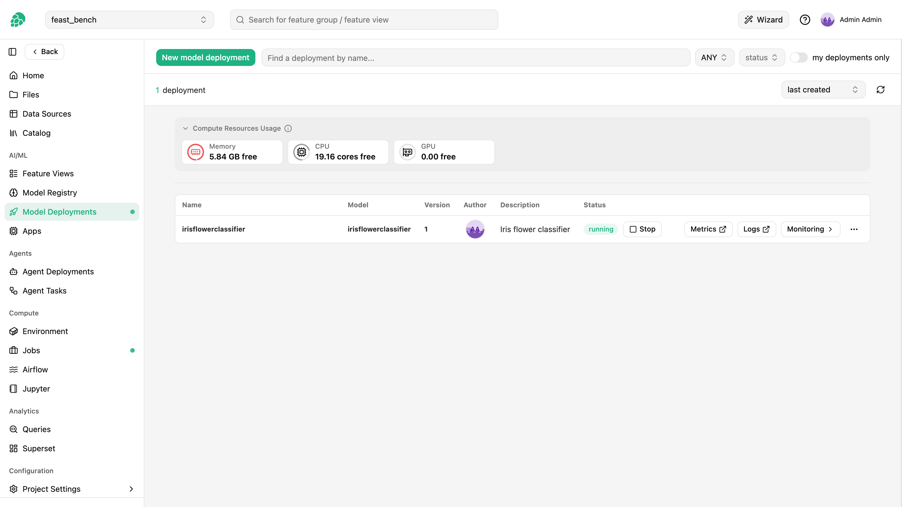
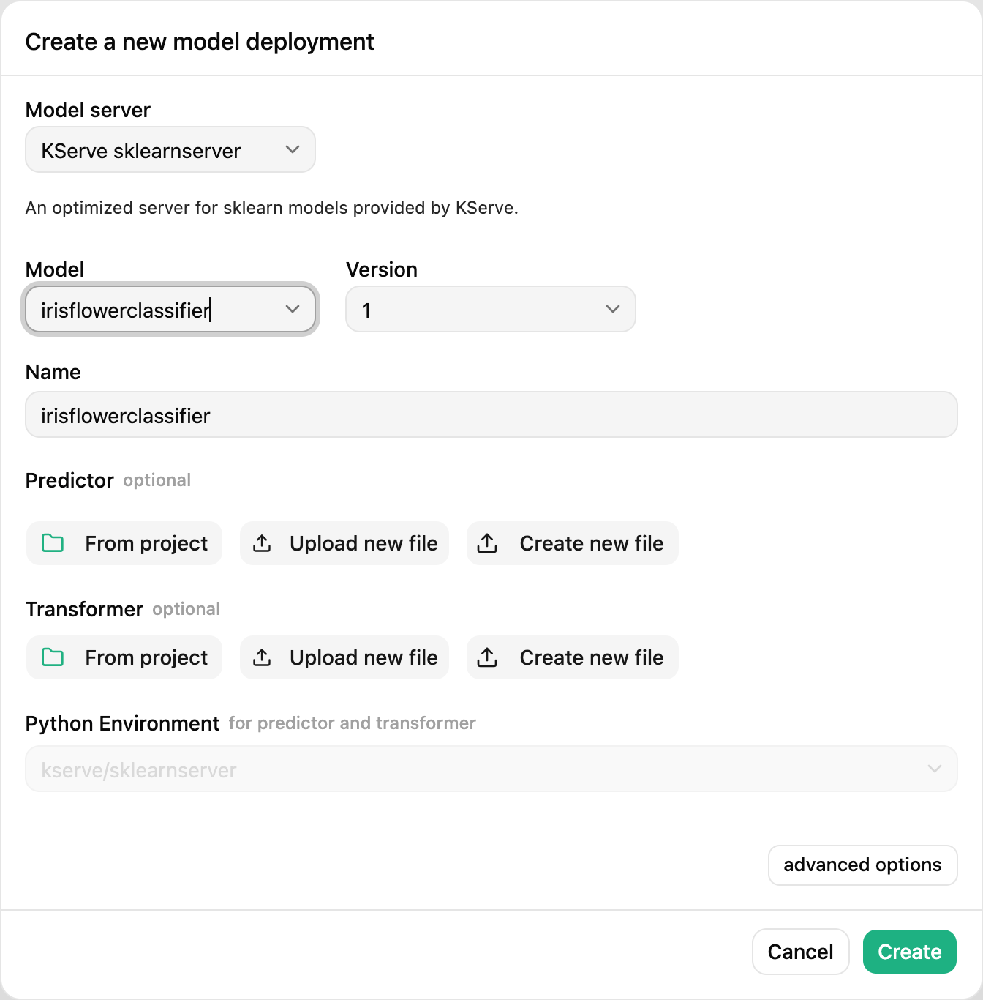
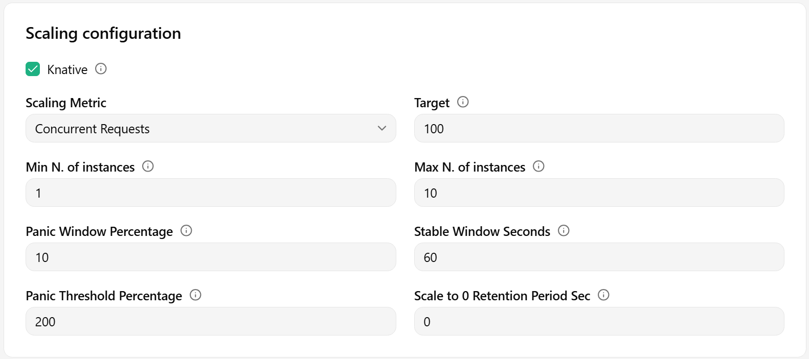
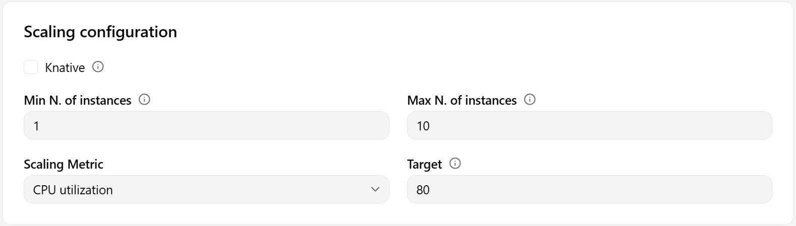

# How To Configure Scaling For A Deployment

## Introduction

This guide explains how to set up **autoscaling** for model deployments using either the [web UI](#web-ui) or the [Python API](#code).

Autoscaling enables the deployment to use resources more efficiently, by growing and shrinking the allocated resources according to its actual, real-time usage.

How a deployment scales depends on the mode it runs in and, in Standard mode, on the autoscaler the cluster provides.
See [Deployment mode](#deployment-mode), [Scale metrics](#scale-metrics), [Scaling parameters](#scaling-parameters) and [Scale to zero when idle](#scale-to-zero-when-idle) for the available scaling options.

## Web UI

### Step 1: Create new deployment

If you have at least one model already trained and saved in the Model Registry, navigate to the deployments page by clicking on the `Deployments` tab on the navigation menu on the left.

<p align="center">
  <figure>
    
    <figcaption>Deployments navigation tab</figcaption>
  </figure>
</p>

Once in the deployments page, you can create a new deployment by either clicking on `New deployment` (if there are no existing deployments) or on `Create new deployment` it the top-right corner.
Both options will open the deployment creation form.

### Step 2: Go to advanced options

A simplified creation form will appear including the most common deployment fields from all available configurations.
Autoscaling is part of the advanced options of a deployment.
To navigate to the advanced creation form, click on `Advanced options`.

<p align="center">
  <figure>
    
    <figcaption>Advanced options. Go to advanced deployment creation form</figcaption>
  </figure>
</p>

### Step 3: Configure autoscaling

In the `Autoscaling` section of the advanced form, you can configure the scaling parameters for the predictor and/or the transformer (if available).
The `Knative` checkbox at the top of the section selects the [deployment mode](#deployment-mode) and decides which of the fields below are shown.
It starts unchecked, so a new deployment runs in Standard mode unless you check it.
The checkbox is disabled while the deployment is running, because the mode of a running deployment cannot be changed.

With the checkbox cleared, the deployment runs in Standard mode and the form shows the fields of the autoscaler the cluster provides.
Its tooltip names the one in effect: KEDA where the cluster has it, KServe's own Horizontal Pod Autoscaler (HPA) otherwise.

- The minimum and maximum instances.
  A minimum of **0** means scale to zero when idle, see [Scale to zero when idle](#scale-to-zero-when-idle).
  The field accepts 0 for the predictor of a deployment without a transformer on a cluster with KEDA.
  Equal minimum and maximum run a fixed number of instances with no autoscaler.
- The scale metric and its target.
  Under KEDA, a vLLM predictor can scale on the engine metrics (queue depth, KV-cache usage, running requests, queue time, time to first token, request latency) and any other predictor without a transformer on the concurrent requests or requests per second at the gateway, next to CPU and memory.
  The target field relabels itself for the chosen metric.
- Under KEDA, the scale-down and scale-up stabilization windows (empty means the cluster default) and one additional scale metric with its target.
- With a minimum of 0, the idle cooldown and the cold-start timeout.
  A vLLM deployment shows a warning, because the model reloads on every wake.

With the checkbox checked, the deployment runs in Knative mode and you can set the scale metric (concurrent requests or requests per second), the target value, the minimum and maximum instances, and the panic and stable window parameters.

<p align="center">
  <figure>
    
    <figcaption>Autoscaling configuration for the predictor and transformer in Knative mode</figcaption>
  </figure>
</p>

<p align="center">
  <figure>
    
    <figcaption>Autoscaling configuration for the predictor and transformer in Standard mode</figcaption>
  </figure>
</p>

Once you are done with the changes, click on `Create new deployment` at the bottom of the page to create the deployment for your model.

!!! note "Deployments stored before KEDA was installed"
    A Standard-mode deployment created on a cluster that then gets KEDA keeps its CPU or memory threshold, and KEDA runs it on its next save or start.
    The edit form shows a note when a stored configuration still names KServe's HPA on a cluster that has KEDA, since saving moves it to KEDA.

## Code

### Step 1: Connect to Hopsworks

=== "Python"

  ```python
  import hopsworks


  project = hopsworks.login()

  # get Hopsworks Model Registry handle
  mr = project.get_model_registry()

  # get Hopsworks Model Serving handle
  ms = project.get_model_serving()
  ```

### Step 2: Define the predictor scaling configuration

You can use the [`PredictorScalingConfig`][hsml.scaling_config.PredictorScalingConfig] class to configure the scaling options according to your preferences.
Default values for scaling metrics and parameters are listed in the [Scale metrics](#scale-metrics) and [Scaling parameters](#scaling-parameters) sections below.
Make sure the metric and parameters you set are valid for the [deployment mode](#deployment-mode) you deploy in.

=== "Standard mode (KEDA)"

    ```python
    from hsml.scaling_config import PredictorScalingConfig, ScaleMetric


    # scale on the requests in flight, measured at the gateway,
    # and rest at zero when idle
    predictor_scaling = PredictorScalingConfig(
        min_instances=0,
        max_instances=5,
        scale_metric=ScaleMetric.CONCURRENCY,
        target=20,
        scale_down_stabilization_window_seconds=120,
        idle_cooldown_seconds=300,
        cold_start_timeout_seconds=120,
    )
    ```

=== "Standard mode (vLLM engine metrics)"

    ```python
    from hsml.scaling_config import PredictorScalingConfig, ScaleMetric


    # add an instance when more than 8 requests are being generated
    # per instance, or when the KV cache passes 80%, whichever comes first
    predictor_scaling = PredictorScalingConfig(
        min_instances=1,
        max_instances=2,
        scale_metric=ScaleMetric.RUNNING_REQUESTS,
        target=8,
        additional_scale_metrics=[(ScaleMetric.KV_CACHE_USAGE, 80)],
    )
    ```

=== "Standard mode (CPU)"

    ```python
    from hsml.scaling_config import PredictorScalingConfig


    predictor_scaling = PredictorScalingConfig(
        min_instances=1, max_instances=5, scale_metric="CPU", target=80
    )
    ```

=== "Knative mode"

    ```python
    from hsml.scaling_config import PredictorScalingConfig


    predictor_scaling = PredictorScalingConfig(
        min_instances=1, max_instances=5, scale_metric="RPS", target=100
    )
    ```

### Step 3 (Optional): Define the transformer scaling configuration

If a transformer script is also provided, you can use the [`TransformerScalingConfig`][hsml.scaling_config.TransformerScalingConfig] class to configure the scaling options according to your preferences.
Default values for scaling metrics and parameters are listed in the [Scale metrics](#scale-metrics) and [Scaling parameters](#scaling-parameters) sections below.
In Standard mode a transformer scales on CPU or memory and keeps at least one instance; the request metrics and scale to zero are for a predictor without a transformer.

=== "Standard mode"

    ```python
    from hsml.scaling_config import TransformerScalingConfig


    transformer_scaling = TransformerScalingConfig(
        min_instances=1, max_instances=3, scale_metric="CPU", target=80
    )
    ```

=== "Knative mode"

    ```python
    from hsml.scaling_config import TransformerScalingConfig


    transformer_scaling = TransformerScalingConfig(
        min_instances=1, max_instances=3, scale_metric="CONCURRENCY", target=50
    )
    ```

### Step 4: Create a deployment with the scaling configuration

=== "Standard mode"

    ```python
    my_model = mr.get_model("my_model", version=1)

    # optional
    my_transformer = ms.create_transformer(
        script_file="Resources/my_transformer.py",
        scaling_configuration=transformer_scaling,
    )

    my_deployment = my_model.deploy(
        scaling_configuration=predictor_scaling,
        # optional:
        transformer=my_transformer,
    )
    ```

=== "Knative mode"

    ```python
    my_model = mr.get_model("my_model", version=1)

    # optional
    my_transformer = ms.create_transformer(
        script_file="Resources/my_transformer.py",
        scaling_configuration=transformer_scaling,
    )

    my_deployment = my_model.deploy(
        scaling_configuration=predictor_scaling,
        knative_mode=True,
        # optional:
        transformer=my_transformer,
    )
    ```

!!! note "Match the scaling configuration to the mode"
    The `knative_mode` argument selects the [deployment mode](#deployment-mode) of the deployment.
    Leaving it unset deploys in Standard mode for every model server, so a Knative scaling configuration needs `knative_mode=True` passed explicitly.
    A scaling configuration that uses fields the chosen mode does not support is rejected, so set both together.

!!! tip "Read the configuration back"
    The backend fills in the defaults and settles the configuration on every start and save.
    `my_deployment.save()` updates the object with what was stored, but `my_deployment.start()` only refreshes the state, so fetch the deployment again (`ms.get_deployment("my_deployment")`) and call `predictor.scaling_configuration.describe()` on it to see the configuration the deployment follows.

!!! api "API reference"

    - <code class="doc-symbol doc-symbol-class"></code> [`PredictorScalingConfig`][hsml.scaling_config.PredictorScalingConfig]
    - <code class="doc-symbol doc-symbol-class"></code> [`TransformerScalingConfig`][hsml.scaling_config.TransformerScalingConfig]
    - <code class="doc-symbol doc-symbol-method"></code> [`ModelServing.create_transformer`][hsml.model_serving.ModelServing.create_transformer]
    - <code class="doc-symbol doc-symbol-method"></code> [`Model.deploy`][hsml.model.Model.deploy]

    <a class="hops-api-cta" href="../../../../python-api/hopsworks/">Browse the full Python API :material-arrow-right:</a>

## Deployment mode

Every deployment runs on KServe in one of two modes.
In ==Standard== mode, the deployment is backed by a plain Kubernetes Deployment and an autoscaler the cluster provides: KEDA where it is installed, KServe's own HPA otherwise.
In ==Knative== mode, the deployment is backed by a Knative service that scales on request traffic.
Inference requests reach both modes through the same Istio endpoint, so the mode does not change how you send predictions to a deployment.

!!! info "Standard and Knative mode"

    | Mode     | Backed by             | Autoscaler                                                                                                                                                                            | Scale-to-zero                                                                        |
    | -------- | --------------------- | ------------------------------------------------------------------------------------------------------------------------------------------------------------------------------------- | ------------------------------------------------------------------------------------ |
    | Standard | Kubernetes Deployment | [KEDA](https://keda.sh/docs/latest/concepts/) where the cluster has it (the default), else [Kubernetes HPA](https://kubernetes.io/docs/tasks/run-application/horizontal-pod-autoscale/) | With KEDA, for a predictor without a transformer, through the KEDA HTTP add-on        |
    | Knative  | Knative service       | [Knative Pod Autoscaler (KPA)](https://knative.dev/docs/serving/autoscaling/)                                                                                                           | Yes                                                                                  |

A new deployment runs in Standard mode for every model server; Knative mode is the opt-in.
An update that leaves the mode unset keeps the stored one.

The two modes are backed by different Kubernetes resources, so the mode of a deployment cannot be changed while it is running.
Stop the deployment, change the mode, and start it again.
Switching the mode clears the scaling settings that do not carry over and re-derives the defaults of the new mode.

### Standard-mode autoscaler

Where the cluster has KEDA, every Standard-mode deployment is scaled by KEDA: on CPU and memory utilization, on the request metrics measured at the gateway by the KEDA HTTP add-on, or on the vLLM engine metrics, with scale to zero when idle.
KEDA is installed by the Hopsworks Helm chart by default, see [KEDA values][helm-values-hw-keda].
A cluster without KEDA falls back to KServe's HPA, which scales on CPU and memory utilization only, always keeps at least one instance, and takes none of the KEDA settings.

The Python SDK exposes the choice as the `autoscaler` argument (`Autoscaler.KEDA` or `Autoscaler.HPA`).
Leaving it unset picks KEDA where it is installed, so there is normally no need to set it; the UI shows no selector and names the autoscaler in effect.
KServe's HPA is kept as the fallback for clusters without KEDA and will be retired.

!!! tip "Python SDK"
    From the Python SDK, the mode is selected with the `knative_mode` keyword
    argument: `True` for Knative mode, `False` for Standard mode.
    Leaving it unset uses Standard mode when creating a deployment,
    and keeps the stored mode when updating one.
    See [`Model.deploy()`][hsml.model.Model.deploy] in the API reference.

## Scale metrics

The metric a deployment can scale on depends on its [deployment mode](#deployment-mode), its autoscaler and its model server.
Setting a metric that the deployment cannot scale on is rejected.
Target values are per instance.

| Scale Metric          | Measures                                                       | Default Target | Standard (KEDA)                   | Standard (HPA) | Knative | Model servers              |
| --------------------- | -------------------------------------------------------------- | -------------- | --------------------------------- | -------------- | ------- | -------------------------- |
| `CPU`                 | CPU utilization, percentage of the request                     | 80             | Yes                               | Yes            | No      | All                        |
| `MEMORY`              | Memory utilization, percentage of the request                  | 80             | Yes                               | Yes            | No      | All                        |
| `CONCURRENCY`         | Concurrent requests, counted at the gateway                    | 100            | Predictor without a transformer   | No             | Yes     | Standard: all but vLLM     |
| `RPS`                 | Requests per second, counted at the gateway                    | 200            | Predictor without a transformer   | No             | Yes     | Standard: all but vLLM     |
| `QUEUE_DEPTH`         | Requests waiting in the engine (`vllm:num_requests_waiting`)   | 5              | Yes                               | No             | No      | vLLM                       |
| `KV_CACHE_USAGE`      | KV-cache in use, percentage (`vllm:kv_cache_usage_perc`)       | 80             | Yes                               | No             | No      | vLLM                       |
| `RUNNING_REQUESTS`    | Requests being generated (`vllm:num_requests_running`)         | 32             | Yes                               | No             | No      | vLLM                       |
| `QUEUE_TIME`          | Average queue time over the last minute, ms                    | 1000           | Yes                               | No             | No      | vLLM                       |
| `TIME_TO_FIRST_TOKEN` | Average time to first token over the last minute, ms           | 2000           | Yes                               | No             | No      | vLLM                       |
| `REQUEST_LATENCY`     | Average end-to-end request latency over the last minute, ms    | 10000          | Yes                               | No             | No      | vLLM                       |

When no metric is set on a range of instances, a vLLM predictor scales on `QUEUE_DEPTH` under KEDA, every other Standard-mode component on `CPU`, and a Knative component on `CONCURRENCY`.
See [Knative autoscaling metrics](https://knative.dev/docs/serving/autoscaling/autoscaling-metrics/) for more details on the Knative metrics.

Setting the minimum and maximum instances to the same value runs a fixed number of replicas instead, with no autoscaler and no scale metric.
LLM deployments default to a fixed replica count, because every extra replica needs a GPU.

!!! info "How KEDA sizes the deployment"
    KEDA runs replicas = ceil(metric value / target).
    The engine metrics are summed over the instances, and the latency metrics are multiplied by the number of instances, so a latency metric grows and shrinks the deployment in proportion to how far the average sits from its target.
    The request metrics count at the gateway: traffic sent straight to the predictor Service from inside the cluster is invisible to them, and to scale to zero.

## Scaling parameters

The following parameters can be used to fine-tune the autoscaling behavior.

| Parameter      | Mode | Default | Range | Description                                                                                                          |
| -------------- | ---- | ------- | ----- | -------------------------------------------------------------------------------------------------------------------- |
| `minInstances` | Both | n/a     | ≥ 0   | Minimum replicas; 0 is [scale to zero when idle](#scale-to-zero-when-idle)                                           |
| `maxInstances` | Both | n/a     | ≥ 1   | Maximum replicas (cannot be less than min)                                                                           |

### KEDA parameters

These apply to a Standard-mode deployment scaled by KEDA.
They are rejected under KServe's HPA, which ignores them, and in Knative mode.

| Parameter                             | Default                     | Range  | Description                                                                                                                |
| ------------------------------------- | --------------------------- | ------ | -------------------------------------------------------------------------------------------------------------------------- |
| `scaleDownStabilizationWindowSeconds` | cluster default (300)       | 0–3600 | How long the metric must stay below target before instances are removed                                                    |
| `scaleUpStabilizationWindowSeconds`   | cluster default (0)         | 0–3600 | How long the metric must stay above target before instances are added                                                      |
| `additionalScaleMetrics`              | none                        | n/a    | Further metric and target pairs; the most demanding one decides the count. At most one request metric per deployment       |
| `idleCooldownSeconds`                 | 300                         | 0–3600 | With a minimum of 0: seconds without a request before every instance is removed, independently of the stabilization window |
| `coldStartTimeoutSeconds`             | 600                         | 1–3600 | With a minimum of 0: how long the first request is held while the deployment wakes                                         |

The cluster defaults of the stabilization windows are set by the administrator in the Helm chart (`kserve.kserve.autoscaler.scaleDownStabilizationWindowSeconds` and `kserve.kserve.autoscaler.scaleUpStabilizationWindowSeconds`, see [KServe values][helm-values-kserve]); empty means the Kubernetes HPA defaults.

### Knative parameters

These apply to a deployment in Knative mode and are rejected in Standard mode.
See [scale bounds](https://knative.dev/docs/serving/autoscaling/scale-bounds/), [autoscaling concepts](https://knative.dev/docs/serving/autoscaling/autoscaling-concepts/) and [scale-to-zero](https://knative.dev/docs/serving/autoscaling/scale-to-zero/) in the Knative documentation for more details.

| Parameter                     | Default | Range  | Description                                 |
| ----------------------------- | ------- | ------ | ------------------------------------------- |
| `panicWindowPercentage`       | 10.0    | 1–100  | Panic window as percentage of stable window |
| `stableWindowSeconds`         | 60      | 6–3600 | Stable window duration in seconds           |
| `panicThresholdPercentage`    | 200.0   | > 0    | Traffic threshold to trigger panic mode     |
| `scaleToZeroRetentionSeconds` | 0       | ≥ 0    | Time to retain pods before scaling to zero  |

!!! note "Cluster-level constraints"
    ==Administrators== can set cluster-wide limits on the maximum and minimum number of instances (`kube_serving_max_num_instances` and `kube_serving_min_num_instances`).
    When the minimum is set to 0, scale-to-zero is enforced for all Knative deployments.
    Whether Standard-mode deployments are scaled by KEDA follows `kube_keda_installed`, which the Helm chart sets when it installs KEDA (on by default), see [Cluster Configuration][cluster-configuration].

## Scale to zero when idle

A minimum of **0** instances means scale to zero when idle, in both modes.
The deployment runs at least one instance while it serves requests, scales between one and the maximum on its metric, and removes all its instances after a period without requests.
The next request wakes it: the request is held while an instance starts and is answered once the instance is ready, so expect a cold start on the first request after an idle period.
A deployment at zero instances reports the `IDLE` status, see [Deployment State](deployment-state.md).

- In **Knative** mode, Knative's autoscaler decides to scale to zero once its stable window (60 seconds by default) has seen no traffic, keeps the last pod for `scaleToZeroRetentionSeconds` beyond that, and holds the next request while a pod starts.
- In **Standard** mode, the KEDA HTTP add-on fronts the deployment.
  Its interceptor counts the requests to the deployment, KEDA removes every instance once `idleCooldownSeconds` have passed without one, and the interceptor holds the next request for up to `coldStartTimeoutSeconds` while an instance starts and passes its readiness probe.
  The idle cooldown is independent of the scale-down stabilization window: once it expires, KEDA scales straight to zero, however many instances are running.
  This requires KEDA on the cluster and a predictor without a transformer.
  A fresh deployment gets a grace period before it may scale to zero, the larger of the idle cooldown and the cold-start timeout, so a long image pull or model load does not end in an immediate scale-down.

Through the SDK the minimum is 1 unless set, so pass `min_instances=0` for scale to zero.
The UI defaults a new deployment to a minimum of 0 wherever it can scale to zero.
A minimum of 0 with a maximum of 1 is one instance while active and zero when idle.

!!! warning "LLM cold starts"
    An LLM deployment reloads its weights into the GPU on every wake, so the first request after an idle period takes as long as the deployment's first start.
    Set `coldStartTimeoutSeconds` above the model's load time; a request held longer than the timeout fails.
    Keep a minimum of 1 for anything with a strict latency objective.

!!! info "Send requests through the endpoint"
    Scale to zero and the request metrics are measured at the gateway.
    Use the deployment's endpoint (`deployment.predict()`, the inference URL, or the OpenAI-compatible URL of a vLLM deployment).
    Traffic sent straight to the predictor Service from inside the cluster never reaches the interceptor and the deployment scales to zero underneath it.

## Rejected configurations

A scaling configuration is validated on create, save and start.
The request fails with a message naming the rule when it:

- sets a minimum of 0 in Standard mode under KServe's HPA, or on a cluster without KEDA;
- sets a minimum of 0, or a request metric (`CONCURRENCY`, `RPS`), on a Standard-mode deployment with a transformer;
- sets `CONCURRENCY` or `RPS` on a vLLM deployment in Standard mode, or an engine metric on another model server;
- sets the KEDA parameters under KServe's HPA, the Knative parameters in Standard mode, or an `autoscaler` in Knative mode;
- sets a maximum of 0, or a maximum below the minimum.

## When a deployment does not scale

- **The configuration is not what was sent.**
  Read it back, see the tip above.
  A metric on a fixed replica count is cleared, and raising the minimum from 0 drops the idle timeouts.
- **The metric does not see the load.**
  Request metrics and scale to zero count at the gateway, so send load through the endpoint.
  Utilization metrics are a percentage of the resource *request*, not the limit: a predictor requesting 2 cores that uses 1 sits at 50%.
- **The maximum is already reached**, by the deployment's own maximum or the administrator's limit; a second vLLM instance also needs a second free GPU.
- **Scale-in waits.**
  While the deployment is active, KEDA waits for the scale-down stabilization window after the metric drops and KServe's HPA for its own 5-minute window.
  Scale to zero follows its own clock: the idle cooldown after the last request, after which KEDA removes every instance at once; a fresh deployment also gets the initial grace period.
- **It does not wake.**
  The cold start must finish within `coldStartTimeoutSeconds`, which for an LLM means the full weight load.
  The deployment's Grafana dashboards, linked from the deployment overview, show the instance count, the KEDA trigger values and the request and engine panels.
  See the [Troubleshooting guide](troubleshooting.md) for the deployment logs.
