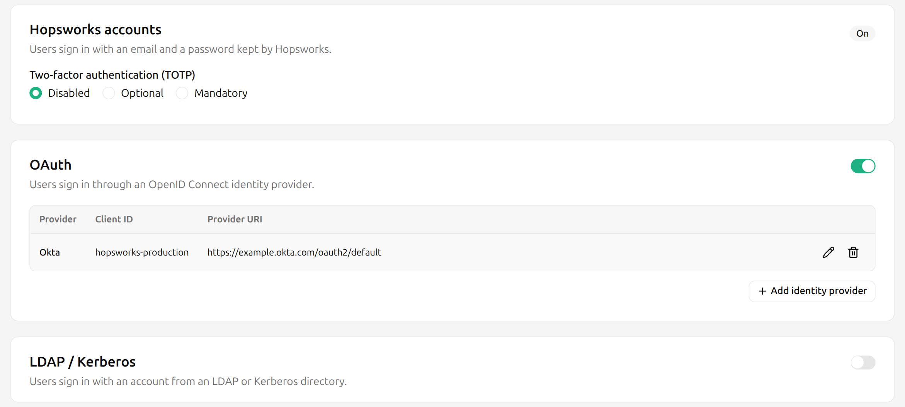

# Authentication Methods

## Introduction

Hopsworks can be configured to use different types of authentication methods.
In this guide we will look at the
different authentication methods available in Hopsworks.

## Prerequisites

Administrator account on a Hopsworks cluster.

### Step 1: Go to Authentication methods page

To configure Authentication methods click on your name in the top right corner of the navigation bar and choose
**Cluster Settings** from the dropdown menu, then choose **Authentication** under _Security & Access_ in the left sidebar.

### Step 2: Configure Authentication methods

On the **Authentication configuration** page you can configure how users authenticate.
Each control is applied as soon as you change it, there is no save step.

1. **Hopsworks accounts**: users log in with credentials managed by Hopsworks itself.
   The card shows _On_ unless password sign-in is turned off with the `disable_password_login` variable, which is not changed from this page.
   Registration is controlled separately: users can register themselves unless `disable_registration` is set, and `disable_registration_ui` only hides the registration form from the login page.
2. **TOTP Two-factor Authentication**: can be _disabled_, _optional_ or _mandatory_.
   If set to mandatory all users are required to set up two-factor authentication when registering.

   !!! note
       If two-factor is set to _mandatory_ on a cluster with preexisting users all users will need to go through lost device recovery step to enable two-factor.
       So consider setting it to _optional_ first and allow users to enable it before setting it to mandatory.

3. **OAuth2**: if your organization already have an identity management system compatible with [OpenID Connect (OIDC)](https://openid.net/connect/) you can configure Hopsworks to use your identity provider by turning on the **OAuth** switch.
   After enabling OAuth you can register your identity provider by clicking **Add identity provider**.
   Registered providers are listed in a table, where the pencil and trash icons edit or remove one.
   See [Create client](./oauth2/create-client.md) for details.
4. **LDAP/Kerberos**: if your organization is using LDAP or Kerberos to manage users and services you can configure Hopsworks to use it as the user management system.
   You can enable it by turning on the **LDAP / Kerberos** switch and choosing LDAP or Kerberos.
   For more information on how to configure LDAP and Kerberos see [Configure LDAP](./ldap/configure-ldap.md) and [Configure Kerberos](./ldap/configure-krb.md).

<figure>
  
  <figcaption>Setup Authentication Methods</figcaption>
</figure>

In the figure above, two-factor authentication is disabled, OAuth is on with one identity provider, and LDAP/Kerberos is off.
