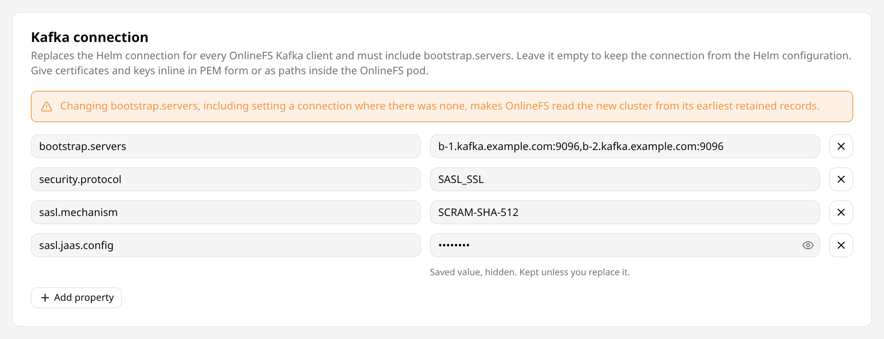
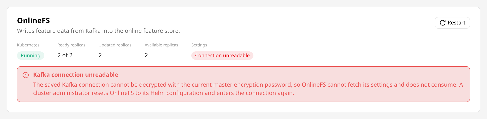
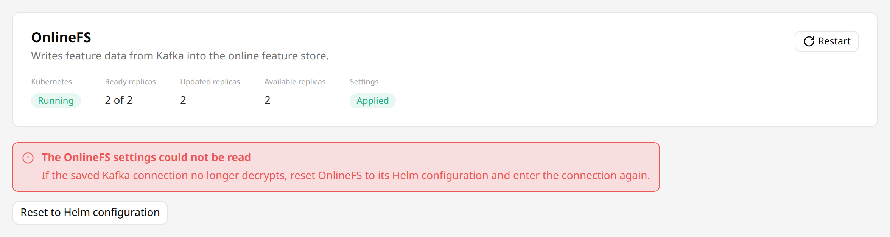
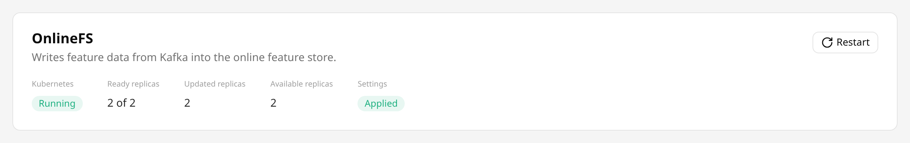

# OnlineFS Configuration { #onlinefs-configuration }

## Introduction { #onlinefs-introduction }

The Online Feature Store service (OnlineFS in short) consumes the feature store topics from Kafka, and writes the feature group rows to the online feature store (RonDB) and the embeddings to the vector database (OpenSearch).
Administrators configure it in Hopsworks under `Cluster Settings` → `OnlineFS`.

The `onlinefs` Helm chart keeps deploying OnlineFS.
Replicas, resources, scheduling, autoscaling and the disruption budget stay in the [OnlineFS Helm values][helm-values-onlinefs].
Hopsworks keeps the settings in its database and changes only one annotation on the pod template of the OnlineFS Deployment, which the chart does not render, so a `helm upgrade` undoes neither and ArgoCD reports no drift.

Hopsworks stores four groups of settings:

- The [Kafka connection][onlinefs-kafka-connection].
- The [topic subscription][onlinefs-subscription].
- The [Kafka client properties][onlinefs-kafka-client-properties] of each Kafka client of OnlineFS.
- The [service settings][onlinefs-service-settings].

At startup, OnlineFS reads its Helm configuration, then fetches the saved settings from Hopsworks and applies them over it.
A saved setting wins over the Helm values and over the environment variables the chart sets.
A setting that was never saved keeps its Helm value, and with nothing saved OnlineFS runs with its Helm configuration.
Hopsworks applies a change by [restarting the OnlineFS pods][onlinefs-applying-changes].

Users who are not administrators see the [status][onlinefs-status] read-only in their project settings, without the revisions and the restart error.

## Kafka connection { #onlinefs-kafka-connection }

The connection is a set of Kafka client properties.
Left empty, which is the default, OnlineFS connects as its Helm configuration says: to the Kafka cluster bundled with Hopsworks, unless `onlinefs.dependencies.kafka` points it elsewhere.

A connection that is set must contain `bootstrap.servers`, and it replaces the Helm connection as a group.
OnlineFS removes the connection keys from the Helm configuration of each of its Kafka clients and uses the entered ones in their place.
The connection keys are `bootstrap.servers`, `bootstrap.controllers`, `security.protocol`, `security.providers`, and every key starting with `ssl.` or `sasl.`.
None of the TLS settings of the chart carry over: the truststore and keystore of the Hopsworks certificates, their passwords, and the empty `ssl.endpoint.identification.algorithm`, which turns off host name verification.
Add the ones the cluster needs to the connection.

The connection applies to every Kafka client of OnlineFS: the consumer that writes to RonDB, the consumer that writes to the vector database, the producer of feature group notifications, and the admin client that reports the consumer group metrics.
Because they all follow one connection, the [client properties][onlinefs-kafka-client-properties] of a single client cannot contain connection keys.

A connection to a cluster with `SASL_SSL` and SCRAM:

```properties
bootstrap.servers=b-1.kafka.example.com:9096,b-2.kafka.example.com:9096
security.protocol=SASL_SSL
sasl.mechanism=SCRAM-SHA-512
sasl.jaas.config=org.apache.kafka.common.security.scram.ScramLoginModule required username="onlinefs" password="<password>";
```

<figure>
  
  <figcaption>A saved SCRAM connection, with its secret hidden</figcaption>
</figure>

Without truststore settings, OnlineFS accepts broker certificates signed by a certificate authority in the default truststore of its JVM.

With an [external Kafka cluster][external-kafka-cluster], enter the cluster that the `kafka_connector` data sources of the projects use.

### Certificates { #onlinefs-kafka-certificates }

Certificates and keys go into the connection either inline in PEM form, or as paths to files inside the OnlineFS pod.
Hopsworks stores the connection as properties only, so a truststore or keystore file has to exist in the pod already.

In PEM form:

| Key | Value |
| --- | --- |
| `ssl.truststore.type` | `PEM` |
| `ssl.truststore.certificates` | The certificates of the certificate authorities that signed the broker certificates. |
| `ssl.keystore.type` | `PEM`, for a cluster that authenticates clients by certificate. |
| `ssl.keystore.certificate.chain` | The client certificate chain. |
| `ssl.keystore.key` | The private key of the client, in PKCS#8 form. |
| `ssl.key.password` | The password of the private key, when it is encrypted. |

A PEM value keeps its line breaks, from the `-----BEGIN` line to the `-----END` line.
Line breaks are accepted only in the values of keys ending in `.certificates`, `.certificate.chain` or `.key`, which can be up to 5000 characters long.
Every other value, in any of the settings on this page, is a single line of at most 1000 characters.
Outside the Kafka connection, keys and values can use only Latin-1 characters, each of the four property maps can hold at most 5000 characters in total, and the topic pattern and the comma-separated topic list are each at most 1000 characters.
The Kafka connection as a whole can hold up to 64 KiB, enough for a CA certificate, a client certificate and a key given inline.

As files, `ssl.truststore.location` and `ssl.keystore.location` point at a truststore and a keystore inside the OnlineFS pod, with their passwords in `ssl.truststore.password`, `ssl.keystore.password` and `ssl.key.password`.
The chart mounts the Hopsworks certificates under `/certs`.

### Credentials { #onlinefs-kafka-credentials }

Hopsworks stores the connection encrypted in its database with the master encryption password, and re-encrypts it when that password changes.
A first connection saved while a master encryption password change is running can stay encrypted with the old password.
An OnlineFS pod that starts then cannot fetch its settings and does not consume, and the [status][onlinefs-status] shows `CONNECTION_UNREADABLE`.

<figure>
  
  <figcaption>The status of a connection that does not decrypt</figcaption>
</figure>

The settings cannot be read either, so the page offers `Reset to Helm configuration` in place of the form.
The reset clears the connection, and it can be entered again.

<figure>
  
  <figcaption>The reset offered when the settings cannot be read</figcaption>
</figure>

Hopsworks shows the value of every key whose name contains `password`, `jaas` or `secret`, or ends in `.key`, as `********`.
Saving with `********` left in place keeps the stored value, so a credential has to be entered again only to change it.
Only OnlineFS receives the values unmasked, and neither Hopsworks nor OnlineFS logs them.

## Subscription { #onlinefs-subscription }

OnlineFS subscribes to its topics either by a pattern or by a list:

- A pattern is a Java regular expression, by default `.*_onlinefs`.
  OnlineFS consumes every topic whose name it matches, including topics created later.
- A topic list names the topics, separated by commas.
  Hopsworks trims the names and drops empty entries and duplicates.
  A name can contain letters, digits, `.`, `_` and `-`, and be up to 249 characters long.

A topic created later is not consumed until it is added to the list, so its data does not reach the online feature store until then.
Hopsworks creates the topics of new feature groups and projects, so subscribe by pattern unless every topic is known in advance.
To consume project topics that do not end in `_onlinefs`, widen the pattern, for example to `.*_onlinefs|fraud_transactions`.
The [ingestion topic][feature-group-ingestion-topic] guide describes which topic a feature group writes to.

Left empty, OnlineFS keeps the subscription of its Helm values, under `onlinefs.configmapOverrides.onlinefssite.kafkaConsumer`.
A saved subscription replaces both Helm values, `topicPattern` and `topicList`, because a non-empty topic list in the Helm values would otherwise take precedence over a saved pattern.

## Kafka client properties { #onlinefs-kafka-client-properties }

Three sets of Kafka client properties tune one client each:

- The consumer properties apply to the consumer that writes feature group rows to RonDB, in the consumer group `onlinefs_rondb`.
- The VectorDB consumer properties apply to the consumer that writes embeddings to the vector database, in the consumer group `onlinefs_vectordb`.
- The producer properties apply to the producer of feature group notifications.

Each set is applied last, over the properties the chart sets for that client and over the connection.
For example, `max.poll.records=500` in the consumer properties replaces the 1000 the chart sets.
The properties the chart sets are in `onlinefs-kafka.properties`, `onlinefs-kafka-vector-db.properties` and `producer.properties` of the OnlineFS ConfigMap.

A set that contains a connection key is refused when saving, because every client follows the one [Kafka connection][onlinefs-kafka-connection].

## Service settings { #onlinefs-service-settings }

Service settings are keys of `onlinefs-site.xml`, written as `section.key`.
Only the keys below are accepted, with a value of the listed type, and every integer must be 0 or more.
`service.threadNumber` and `service.reportingQueueSizePerThread` must be at least `1`, because OnlineFS sizes its reporting thread pool and queues from them and cannot start with `0`.
`rondb.batchSize` and `opensearch.batchSize` must be at least `1`, because OnlineFS splits the rows it writes into batches of that size.
`service.ronDbThreadNumber` and `service.vectorDbThreadNumber` cannot both be `0`, because OnlineFS would then consume nothing.
The default is the value the chart sets, or the default of OnlineFS where the chart sets none.

**`service`**

| Key | Type | Default | Description |
| --- | --- | --- | --- |
| `service.threadNumber` | integer | `10` | Maximum number of threads that report ingestion to Hopsworks and send feature group notifications. |
| `service.ronDbThreadNumber` | integer | `10` | Number of Kafka consumer threads that write to RonDB. |
| `service.vectorDbThreadNumber` | integer | `10`, or `0` without VectorDB ingestion | Number of Kafka consumer threads that write embeddings to the vector database. Set it above 0 only when `onlinefs.deployment.vectordb.enabled` is true, because only then does the chart provide the OpenSearch credentials. |
| `service.reportingQueueSizePerThread` | integer | `100` | Queue size per reporting and notification thread. |
| `service.getSessionRetrySleepMs` | integer | `100` | Milliseconds between attempts to get a RonDB session. |
| `service.pauseRetrySleepMs` | integer | `5000` | Milliseconds between attempts while ingestion is paused on a failure that looks transient, such as a RonDB or Hopsworks upgrade. |
| `service.maxPauseMs` | integer | `0` | Milliseconds after which OnlineFS gives up on a batch paused on such a failure, and drops its rows. `0` waits until the failure resolves. |
| `service.maxBlacklistSize` | integer | `100` | Maximum number of entries in the lists of feature groups and projects whose records OnlineFS skips. |
| `service.maxFeatureGroupCacheSize` | integer | `1000` | Maximum number of entries in the feature group metadata cache. |
| `service.maxFeatureStoreCacheSize` | integer | `1000` | Maximum number of entries in the feature store metadata cache. |
| `service.maxFeatureViewCacheSize` | integer | `1000` | Maximum number of entries in the feature view metadata cache. |
| `service.featureGroupCacheExpire` | integer | `30` | Minutes after which a feature group cache entry expires. |
| `service.featureStoreCacheExpire` | integer | `30` | Minutes after which a feature store cache entry expires. |
| `service.featureViewCacheExpire` | integer | `10` | Minutes after which a feature view cache entry expires. |
| `service.verifyFeatureGroupTopic` | boolean | `true` | Drop records that did not arrive on the online topic of the feature group their headers name. See [OnlineFS drops records that arrive on another topic][upgrade-onlinefs-topics] before turning it off. |
| `service.region` | string | none | Region written into feature group notifications. |

**`rondb`**

| Key | Type | Default | Description |
| --- | --- | --- | --- |
| `rondb.batchSize` | integer | `300` | Maximum number of rows per RonDB commit. |
| `rondb.maxRetries` | integer | `3` | Retries of a failed RonDB commit. |
| `rondb.missingTableRetries` | integer | `5` | Lookups of a table that RonDB reports as missing, before OnlineFS treats its feature group as deleted. |
| `rondb.maxCachedSessions` | integer | `20` | Maximum number of ClusterJ sessions cached per connection. |
| `rondb.maxCachedInstances` | integer | `1024` | Maximum number of ClusterJ instances cached. |
| `rondb.reconnectTimeout` | integer | `5` | ClusterJ reconnect timeout, in seconds. |
| `rondb.maxTransactions` | integer | `1024` | Maximum number of concurrent ClusterJ transactions. |
| `rondb.useSessionCache` | boolean | `false` | Return ClusterJ sessions to a cache instead of closing them. |
| `rondb.useDynamicObjectCache` | boolean | `false` | Return ClusterJ objects to a cache instead of releasing them. |

**`kafkaConsumer`**

| Key | Type | Default | Description |
| --- | --- | --- | --- |
| `kafkaConsumer.pollTimeoutMs` | integer | `1000` | Kafka consumer poll timeout, in milliseconds. |

**`opensearch`**

| Key | Type | Default | Description |
| --- | --- | --- | --- |
| `opensearch.batchSize` | integer | `1000` | Maximum number of embeddings per vector database commit. |
| `opensearch.maxRetries` | integer | `10` | Retries of a failed vector database commit. |

Every other key is refused:

- `kafkaConsumer.topicPattern` and `kafkaConsumer.topicList` are set through the [subscription][onlinefs-subscription].
- `hopsworks.*`, `kafka.propertiesFile*`, `metrics.port`, `rondb.connectionString`, `opensearch.host`, `opensearch.userName` and `opensearch.password` come from the deployment: the endpoints, the credentials, the files the chart mounts, and the port its probes check.
- `rondb.poolSize` stays in the Helm values, because every pooled connection of every pod takes a RonDB API slot from the pool that the HopsFS NameNodes also use.

## Applying changes { #onlinefs-applying-changes }

`Save`, `Restart` and `Reset to Helm configuration` each restart OnlineFS:

- `Save` stores the settings.
- `Restart` leaves the settings as they are.
- `Reset to Helm configuration` clears every saved setting, so OnlineFS returns to its Helm configuration.

Hopsworks restarts OnlineFS with a rollout of its Deployment, as `kubectl rollout restart` does.
It writes the revision of the saved settings into the `onlinefs.hopsworks.ai/settings-revision` annotation of the pod template, and Kubernetes replaces the pods.
Each new pod fetches the settings when it starts.
A change saved during a rollout is applied by a further rollout once that one ends.

The rollout strategy of the Deployment decides the order in which pods are replaced:

- With a single replica the chart sets no strategy, so Kubernetes starts the new pod first and stops the old one once the new one is ready.
- With two or more replicas the chart stops a pod before it starts its replacement, so that a rollout completes on a node pool with no room for an extra pod.
  The other pods keep consuming meanwhile.
- `onlinefs.deployment.strategy` in the Helm values replaces both, for example with `maxSurge: 1` and `maxUnavailable: 0` to start every new pod first.
  It applies to Helm upgrades as well.

A new pod started first needs room on the node pool, and free RonDB API slots for its connections.
Kubernetes counts a pod as ready once its metrics port answers, so an old pod can stop shortly before its replacement consumes.
Kafka keeps the records while pods are replaced, and OnlineFS continues from its stored offsets.

When Kubernetes reports that the rollout cannot progress, for example because a new pod cannot be scheduled or keeps crashing, the restart stops and the status shows the settings as `FAILED`, with the reason.
Fix the cause and press `Restart`.

## Status { #onlinefs-status }

The status shows the state of the OnlineFS Deployment, its desired, ready, updated and available replicas, and whether the latest settings are applied.

<figure>
  
  <figcaption>The OnlineFS status, with the Restart action</figcaption>
</figure>

| State | Meaning |
| --- | --- |
| `RUNNING` | The Deployment runs its replicas and no rollout is in progress. |
| `UPDATING` | A rollout is in progress. |
| `STOPPED` | The Deployment has 0 replicas. |
| `FAILED` | Kubernetes reports that the rollout cannot progress, with the reason. |
| `NOT_FOUND` | No Deployment named by the `onlinefs_deployment_name` variable, by default `onlinefs-deployment`, exists in the namespace Hopsworks is installed in. |
| `UNKNOWN` | Hopsworks does not run on Kubernetes. |

| Settings state | Meaning |
| --- | --- |
| `NONE` | Nothing was ever saved, and OnlineFS runs with its Helm configuration. |
| `PENDING` | Settings were saved or reset, or `Restart` was pressed, and the rollout has not completed yet. |
| `FAILED` | The last restart stopped on an error, shown with the status. |
| `NOT_FETCHED` | The pods were replaced, but none fetched the latest settings, because the OnlineFS image they run does not fetch settings from Hopsworks. |
| `CONNECTION_UNREADABLE` | The saved Kafka connection does not decrypt with the current master encryption password, so an OnlineFS pod that starts cannot fetch its settings. It takes precedence over the other states. See [Credentials][onlinefs-kafka-credentials]. |
| `APPLIED` | The pods were replaced and fetched the latest settings. |

`APPLIED` says nothing about whether OnlineFS reaches the Kafka cluster.
The OnlineFS logs and the OnlineFS dashboard show that.

Administrators also see the revision of the saved settings, the revision the last completed restart applied, the revision OnlineFS fetched last, and the error of the last restart.

## Consumer offsets { #onlinefs-offsets }

OnlineFS stores its consumer offsets in the online feature store of each project, per consumer group, topic and partition.
It keeps the offsets of a saved connection apart from those of the Helm connection, and starts new ones whenever the saved `bootstrap.servers` changes:

- With the Helm connection, OnlineFS uses the offsets it has always used, so an upgraded cluster resumes where it was.
- A saved connection whose `bootstrap.servers` differs from the previous one, or a connection saved where there was none, starts a new set of offsets.
  OnlineFS then reads that cluster from the earliest records it retains, because the chart sets `auto.offset.reset=earliest`.
  This also holds for a cluster OnlineFS used before.
- Changing any other key of the connection, such as the credentials, keeps the offsets.
- Resetting to the Helm configuration returns to the offsets of the Helm connection.

Hopsworks tells Kafka clusters apart by `bootstrap.servers` alone.
A new broker list for the same cluster, or moving a connection from the Helm values into Cluster Settings, also makes OnlineFS read the retained records again and write them to the online feature store again.
Plan such a change for a time when that load is acceptable.
A change of the Helm connection itself, in the Helm values, keeps the offsets of the Helm connection, as in earlier releases.

## Startup { #onlinefs-startup }

Each OnlineFS pod asks Hopsworks for the saved settings once at startup, before it consumes.
Hopsworks answers only the OnlineFS service user, named by the `onlinefs_service_user_email` variable, by default `onlinefs@hopsworks.ai`, because the answer contains the Kafka credentials.

- When Hopsworks answers, OnlineFS applies the saved settings, or runs with its Helm configuration when nothing is saved.
- When Hopsworks is an older release without these settings, OnlineFS runs with its Helm configuration.
- When Hopsworks cannot be reached, answers with a server error, or refuses the API key, OnlineFS logs the error and asks again, after 1 second at first and doubling up to 60 seconds.

In the last case OnlineFS does not fall back to its Helm configuration, because that could make it consume from another Kafka cluster than the one saved, while waiting loses nothing: Kafka keeps the records.
A pod that starts while Hopsworks is down therefore waits for Hopsworks, whether settings are saved or not.
Running pods are not affected, since they ask only at startup.

## Permissions on the Kafka cluster { #onlinefs-kafka-permissions }

On a Kafka cluster with authorization, the principal of the connection needs:

| Resource | Operations | Needed for |
| --- | --- | --- |
| The topics OnlineFS subscribes to | Describe, Read | Consuming the feature group rows. |
| The consumer groups `onlinefs_rondb` and `onlinefs_vectordb` | Describe, Read | Joining the consumer groups and reporting their metrics. |
| The notification topics of feature groups | Write | Sending feature group notifications. |

A `group.id` in the consumer properties or the VectorDB consumer properties changes the name of the consumer group to grant.
OnlineFS creates no topics.
On an external Kafka cluster, Hopsworks creates them with the `kafka_connector` data source of each project, as described in [Topics on the external Kafka cluster][topics-on-the-external-kafka-cluster].

## REST API { #onlinefs-rest-api }

Administrators can manage the settings with the REST API, also with an API key of scope `ADMIN`:

```text
GET    /hopsworks-api/api/admin/onlinefs/config
PUT    /hopsworks-api/api/admin/onlinefs/config
DELETE /hopsworks-api/api/admin/onlinefs/config
POST   /hopsworks-api/api/admin/onlinefs/restart
GET    /hopsworks-api/api/admin/onlinefs/status
```

`PUT` saves the settings and `DELETE` resets them to the Helm configuration, and both return the resulting settings.
`POST` on `restart` restarts OnlineFS with the settings unchanged and returns the status.
All three restart OnlineFS as described in [Applying changes][onlinefs-applying-changes].

```json
{
  "kafkaConnection": {
    "bootstrap.servers": "b-1.kafka.example.com:9096",
    "security.protocol": "SASL_SSL",
    "sasl.mechanism": "SCRAM-SHA-512",
    "sasl.jaas.config": "********"
  },
  "topicPattern": ".*_onlinefs",
  "topicList": null,
  "kafkaConsumerOverrides": {"max.poll.records": "500"},
  "kafkaProducerOverrides": {},
  "kafkaVectordbOverrides": {},
  "siteOverrides": {"service.ronDbThreadNumber": "12"},
  "revision": 7,
  "updated": "2026-10-27T15:00:00.000Z"
}
```

- A `PUT` replaces every setting, so send the whole configuration as a `GET` returns it.
- An empty or absent `kafkaConnection` keeps the Helm connection.
- At most one of `topicPattern` and `topicList` is set, and `topicList` is an array of topic names.
  With both `null`, OnlineFS keeps the subscription of its Helm values.
- A value of `********` keeps the stored value of that key.
- `revision` and `updated` are read-only and ignored on `PUT`.

Every logged-in user can read the status of OnlineFS with `GET /hopsworks-api/api/onlinefs/status`, also with an API key of scope `FEATURESTORE`.
It returns the state, the replica counts, the message, the settings state, and whether any setting is saved, without the revisions and the restart error.
