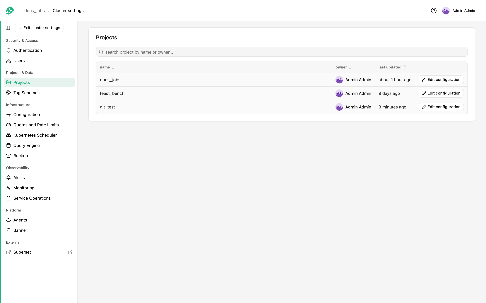
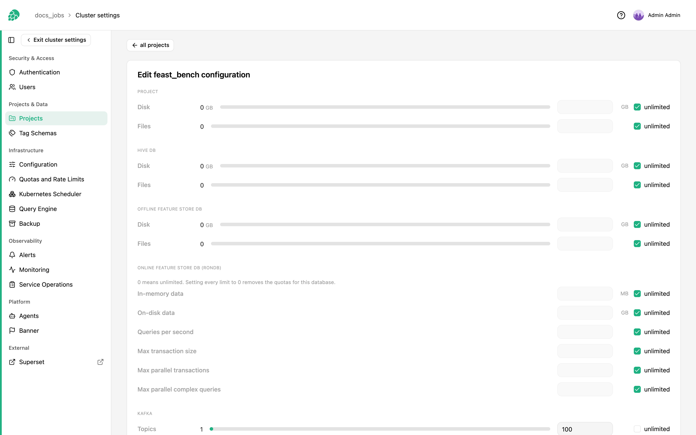

# Manage Projects

Hopsworks provides an administrator with a view of the projects in a Hopsworks cluster.

A Hopsworks administrator is not automatically a member of all the projects in a cluster.
However, they can see which projects exist, who is the project owner, and they can limit the storage quota and compute quota for each project.
They can also transfer a project to a new owner.

## Prerequisites

You need to be an administrator on a Hopsworks cluster.

## Changing project quotas

You can find the Project management page by clicking on your name, in the top right corner of the navigation bar, choosing _Cluster Settings_ from the dropdown menu, then choosing _Projects_ under _Projects & Data_ in the left sidebar.

<figure>
  
  <figcaption>Project page</figcaption>
</figure>

This page will list all the projects in a cluster, their name, owner and when its quota was last updated.
By clicking on the _edit configuration_ link of a project you will be able to edit the quotas of that project.

<figure>
  
  <figcaption>Project quotas</figcaption>
</figure>

### Storage

Storage quota represents the amount of data a project can store.
The storage quota is broken down in two different areas:

- **Feature Store**: This represents the storage quota for files and directories stored in the `_featurestore.db` dataset in the project.
This dataset contains all the feature group offline data for the project.
- **Project**: This represents the storage quota for all the data stored on any other dataset.

Each storage quota is divided into space quota, i.e., how much space the files can consume, and namespace quota, i.e., how many files and directories there can be.
If Hopsworks is deployed on-premise using hard drives to store the data, i.e., Hopsworks is not configured to store its data in a S3-compliant storage system, the data is replicated across multiple nodes (by default 3) and the space quota takes the replication factor into consideration.
As an example, a 100MB file stored with a replication factor of 3, will consume 300MB of space quota.

By default, all storage quotas are disabled and not enforced.
Administrators can change this default by changing the following configuration in the [Configuration](../admin/variables.md) UI and/or the cluster definition:

```yaml
hopsworks:
    featurestore_default_quota: [default quota in bytes, -1 to disable]
    hdfs_default_quota: [default quota in bytes, -1 to disable]
```

The values specified will be set during project creation and administrators will be able to customize each project using this UI.

### Compute

Compute quotas represents the amount of compute a project can use to run Spark applications as well as Tez queries.
Quota is expressed as number of seconds a container of size 1 CPU and 1GB of RAM can run for.

If the Hopsworks cluster is connected to a Kubernetes cluster, Python jobs, Jupyter notebooks and KServe models are not subject to the compute quota.
Currently, Hopsworks does not support defining quotas for compute scheduled on the connected Kubernetes cluster.

By default, the compute quota is disabled.
Administrators can change this default by changing the following configuration in the [Configuration](../admin/variables.md) UI and/or the cluster definition:

```yaml
hopsworks:
    yarn_default_payment_type: [NOLIMIT to disable the quota, PREPAID to enable it]
    yarn_default_quota: [default quota in seconds]
```

The values specified will be set during project creation and administrators will be able to customize each project using this UI.

### Kafka Topics

Kafka is used within Hopsworks to enable users to write data to the feature store in Real-Time and from a variety of different frameworks.
If a user creates a feature group with the stream APIs enabled, then a Kafka topic will be created for that feature group.
By default, a project can have up to 100 Kafka topics.
Administrators can increase the number of Kafka topics a project is allowed to create by increasing the quota in the project admin UI.

### OpenSearch

A project stores its vector (embedding) indices, and any indices its data owners create, in the cluster's OpenSearch.
Three quotas limit what it can store there:

- **Max vector index size**: the size, in MB of primary store, each of the project's vector indices may reach.
- **Max OpenSearch index size**: the same for each index the project creates itself, named after the project.
- **Max number of vector indexes**: how many vector indices the project may have.
  Creating a feature group that would need another one fails with an error naming the limit.

An index that reaches its size limit turns read-only: rows written to it afterwards fail, while reads keep working.
OpenSearch checks the size every five minutes or so, so an index can grow past the limit by what is written in between.

All three quotas are unlimited by default.
Administrators can change the defaults on the _Quotas and Rate Limits_ page of the cluster settings, or by setting the following configuration in the [Configuration](../admin/variables.md) UI and/or the cluster definition:

```yaml
hopsworks:
    opensearch_default_max_vector_index_size_mb: [size limit of each vector index in MB, -1 for unlimited]
    opensearch_default_max_index_size_mb: [size limit of each other project index in MB, -1 for unlimited]
    opensearch_default_max_num_embedding_indices: [number of vector indices, -1 for unlimited]
```

Unlike the storage quotas, the defaults apply to every project that has no limit of its own, including existing ones.
An administrator can give a project its own limits in this UI, or put it back on the defaults.
Raising a project's index size limit makes its read-only indices writable again within a few minutes.

## Force deleting a project

Administrators have the option to force delete a project.
This is useful if the project was not created or deleted properly, e.g., because of an error.
It is also how an administrator deletes a project they do not own, since only the owner can delete a project from its settings.
To force delete a project, click _Edit configuration_ next to it on the Project management page, then click _Force delete project_ under _Manage project_ and confirm.

## Transferring a project to a new owner

Every project has one owner, the user who created it unless it has been transferred since.
The owner cannot be removed from the project and their role cannot be changed, so a project stays attached to an owner who has left until it is transferred.

To transfer a project, click _Edit configuration_ next to it on the Project management page, then click _Transfer ownership_ under _Manage project_, choose the new owner and confirm.
Any activated user with the user or administrator role can be chosen.
The new owner is added to the project as a Data owner, or promoted to one, if they are not one already.
A member holding a custom role is given the built-in Data owner role in its place.
The previous owner stays a Data owner, and can then be removed like any other member.
The project limit of the new owner does not apply to a transfer made by an administrator.

The transfer also gives the new owner:

- the ownership of the project's root directory
- the ownership of the datasets created with the project, so removing the previous owner leaves none of them with someone who is no longer a member: `Logs`, `Resources`, the datasets of the project's services such as `Jupyter`, `Models` or the training datasets, each with its `README.md`, and the project's feature store and Hive databases; datasets members created stay theirs, and so do the other files inside each dataset
- the project count of the previous owner, which decides how many more projects each of them can create
- the API keys of the project's Airflow DAGs, which run as the project owner

If one of these steps fails, the owner has still changed and the transfer reports which step did not complete.
Transfer the project to its current owner again to finish it, with the REST API below: the _Transfer ownership_ dialog does not offer the current owner.
The permissions check that runs periodically also gives the project's root directory and the datasets created with the project back to the current owner.

One transfer of a project runs at a time.
While a transfer is still completing these steps, another transfer of the same project is refused with error code 150128, and composing or deleting one of the project's Airflow DAGs is refused with 290009, since the transfer replaces the DAGs' API keys.
A transfer interrupted by a restart keeps other transfers of the project out for up to 15 minutes.

The same transfer is available over the REST API, with the id of the project and of the new owner:

```bash
curl -X PUT -H "Authorization: ApiKey <administrator API key>" \
  "https://<hopsworks>/hopsworks-api/api/admin/projects/<project id>/owner/<user id>"
```

How ownership interacts with group mapping is described in [Ownership and group mapping][ownership-and-group-mapping].

## Controlling who can create projects

Every user on Hopsworks can create projects.
By default, each user can create up to 10 projects.
For production environments, the number of projects should be limited and controlled for resource allocation purposes as well as closer control over the data.
Administrators can control how many projects a user can provision by setting the following configuration in the [Configuration](../admin/variables.md) UI and/or cluster definition:

```yaml
hopsworks:
    max_num_proj_per_user: [Maximum number of projects each user can create]
```

This value will be set when the user is provisioned.
Administrators can grant additional projects to a specific user through the [User Administration](../admin/user.md) UI.
