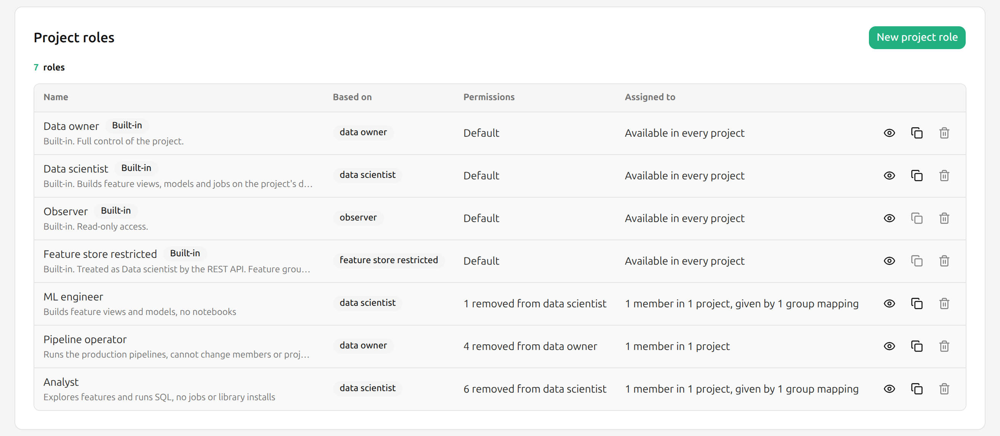
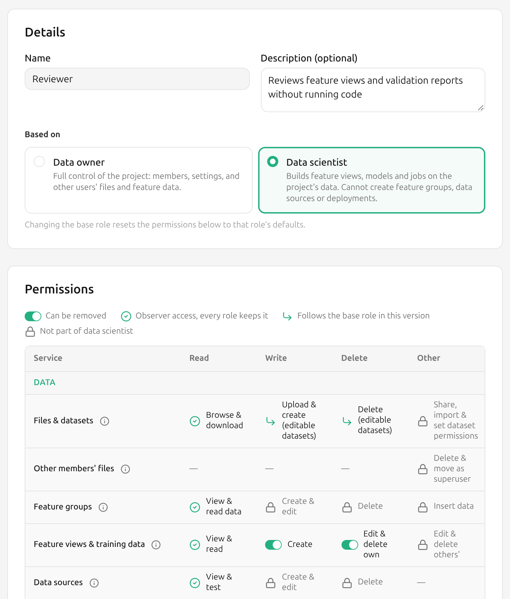
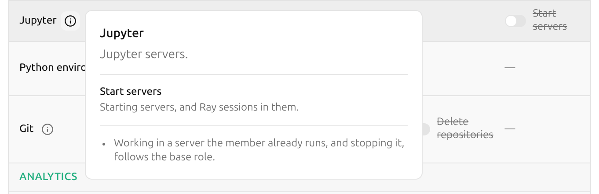
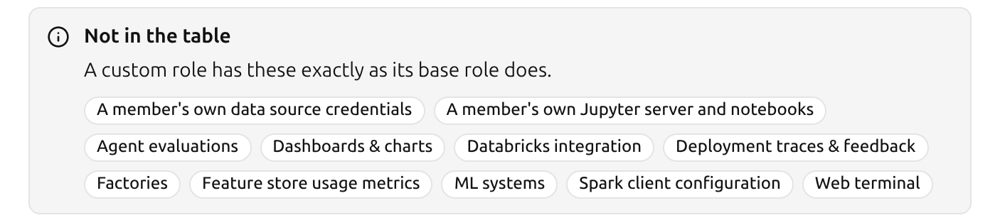

# Custom Project Roles { #custom-project-roles }

## Introduction

Every member of a project holds a project role.
Hopsworks has four built-in roles, Data owner, Data scientist, Observer and Feature store restricted, described in [How To Manage Members To A Project][how-to-manage-members-to-a-project].

A custom project role is a Data owner or a Data scientist with some permissions removed.
A cluster administrator defines it once, and Data owners can then give it to members in every project, like a built-in role.
A custom role never allows more than the role it is based on, and it always allows what an Observer can do.

A member holding a custom role is refused every request that needs a permission the role removed, with HTTP 403.
Most refusals carry status code 150068 and name the permission:

```json
{
  "errorCode": 150068,
  "usrMsg": "Your project role does not allow Kafka: Manage schemas"
}
```

## Prerequisites

You need to be an administrator on a Hopsworks cluster.

## Enable custom project roles { #enable-custom-project-roles }

Custom project roles are off by default.
Turn them on with the `enable_custom_project_roles` variable in the Helm values:

```yaml
hopsworks:
  variables:
    enable_custom_project_roles: "true"
```

The chart writes the variable on every install and upgrade, so a value set on the [Cluster Configuration][cluster-configuration] page lasts only until the next upgrade.

With the variable on, _Project Roles_ appears under _Security & Access_ in _Cluster Settings_, and the role pickers for project members and group mappings list the custom roles.
With the variable off again, custom roles can no longer be given to members or picked for a group mapping.
A group mapping that already names a custom role keeps giving it to the users it adds or updates; change or delete the mapping to stop that.
Members who already hold one keep it and are still refused what it removed.

!!! warning "Rolling upgrades"
    A Hopsworks instance running a release without custom project roles does not know them, and lets a member holding one do everything the base role allows.
    Give members custom roles only once every Hopsworks instance runs the new release.

## Create a custom role { #create-a-custom-project-role }

Click your name in the top right corner of the navigation bar, choose _Cluster Settings_, then choose _Project Roles_ under _Security & Access_ in the left sidebar.
The list shows the built-in roles next to the custom ones, with how many members hold each role.
Click _New project role_, or _Duplicate_ on Data owner, Data scientist or a custom role to start from it.

<figure>
 <a href="../../../assets/images/admin/project-roles/project-roles-list.png">
   
 </a>
 <figcaption>Project roles</figcaption>
</figure>

Fill in the role:

- _Name_: up to 32 letters, digits, spaces, `-` and `_`.
  The names of the built-in roles are reserved, whatever their case and separators, so `data_owner` is refused too.
- _Description_: optional, up to 512 characters.
- _Based on_: Data owner or Data scientist.
  It cannot be changed once the role exists, because members holding the role keep the base role in every system outside Hopsworks' own checks.
- _Permissions_: one row per project service and one column per action.
  Switch off what members holding the role must not do.
  The info button next to a service says what the service covers.

<figure>
 <a href="../../../assets/images/admin/project-roles/project-role-editor.png">
   
 </a>
 <figcaption>New project role</figcaption>
</figure>

The _Summary_ shows which role the new one behaves as and what it removes.
Click _Create role_.
A role must remove at least one permission, otherwise it would be its base role under another name.

### What the permission cells mean

| Cell | Meaning |
| --- | --- |
| Allowed or Removed | A permission the role can remove. |
| Always allowed | What an Observer can do. Every project role keeps it. |
| Follows the base role | Also granted by a system outside Hopsworks' own checks, named in the tooltip. A custom role cannot remove it. |
| Not part of this role | The base role does not have it, for example _Edit & delete others'_ feature views for a Data scientist. |

A permission follows the base role when a member can exercise it without going through Hopsworks, so removing it in Hopsworks alone would not stop them:

| Service | Permission | Also granted through |
| --- | --- | --- |
| Files & datasets | Upload & create, Delete (editable datasets) | HopsFS |
| Feature groups | Insert data | Kafka and HopsFS |
| Tags | Write tag values | HopsFS, where a tag is an extended attribute on the entity's inode |
| Model registry | Register & edit, Delete | HopsFS |
| Model inference | Send predictions | The model serving authenticator |
| Airflow | Edit DAGs, Delete DAGs | HopsFS and the Airflow plugin |
| SQL queries | Run SQL | Trino JDBC |
| Superset | View dashboards, Edit dashboards | Superset's own roles |
| Kafka | Create topics | Kafka clients |

Data validation and feature monitoring create and run jobs.
Switching off _Jobs: Create & edit_ or _Jobs: Run & stop_ therefore also switches off _Data validation: Run validation_ and _Feature monitoring: Create & edit configs_, and neither can be switched back on while a job permission is off.
The chat app, the evaluation job and the feedback review job of an agent deployment are jobs too, so creating or changing one also needs _Jobs: Create & edit_, and starting one _Jobs: Run & stop_.
The evaluation job Hopsworks creates with default settings, when the deployment is created or its first evaluation run starts, does not need _Jobs: Create & edit_.

### What each service covers

The info button shows the same: what the service is, what each cell covers where its name does not say it all, and facts that hold for the whole row.

<figure>
 <a href="../../../assets/images/admin/project-roles/project-role-service-info.png">
   
 </a>
 <figcaption>The info button of a service</figcaption>
</figure>

| Service | Covers |
| --- | --- |
| Files & datasets | Datasets and the files in them.<br>**Browse & download**: browsing and searching files, and reading their extended attributes.<br>**Share, import & set dataset permissions**: sharing a dataset with another project, importing one shared with this project, and changing a dataset's permissions. |
| Other members' files | Deleting and moving files other members created.<br>**Delete & move as superuser**: a Data owner's deletes and moves in the project's own datasets run as the HopsFS superuser. Without it they run as the member, and HopsFS permissions apply.<br>Members' home directories are never changed this way. |
| Feature groups | Feature groups and the feature store itself.<br>**View & read data**: feature group data, previews, statistics, commits, activity and provenance, and feature store search.<br>**Create & edit**: creating and editing feature groups, and importing feature store defaults.<br>**Delete**: deleting and clearing feature groups.<br>**Insert data**: commits, online ingestion and metastore sync. |
| Feature views & training data | Feature views and training datasets.<br>**View & read**: their queries, prepared statements, serving keys, transformations and feature logs.<br>**Create**: creating feature views, and creating and computing training data.<br>**Edit & delete own**: feature views and training datasets the member created.<br>**Edit & delete others'**: feature views and training datasets other members created. |
| Data sources | Data sources, SharePoint syncs, and the project's Trino catalogs.<br>**View & test**: browsing a data source's databases, tables and data, testing connections, and reading Trino catalogs and their shares.<br>**Create & edit**: creating and editing data sources, creating, editing and sharing the project's Trino catalogs, and managing SharePoint syncs.<br>**Delete**: deleting data sources and the project's Trino catalogs.<br>A private Trino catalog belongs to the member who created it, whatever their role. A private Trino catalog on a data source whose credentials each member provides needs only View & test. |
| Feature store sharing | Sharing this project's feature store, or single feature groups, with other projects.<br>**Unshare**: removing this project's shares, and shares this project received. |
| Fine-grained access | Grants that give Feature store restricted members access to individual feature groups.<br>**Grant feature group access**: to all of a feature group's features or some. |
| Transformation functions | Transformation functions registered in the project's feature store. |
| Data validation | Expectation suites, expectations and validation reports on feature groups.<br>**Run validation**: starts a validation job, so it also needs _Jobs: Run & stop_. |
| Feature monitoring | Feature monitoring configurations and results on feature groups, feature views and models.<br>**Create & edit configs**: a configuration schedules a monitoring job, so it also needs _Jobs_. |
| Tags | Tags and keywords on datasets, feature groups, feature views, training datasets, data sources, jobs, models and deployments. |
| Model registry | Models in the model registry, Hugging Face imports included.<br>**View & download**: models, their provenance, and the deployment configurations generated from them. |
| Model deployments | Model deployments and their chat apps.<br>**View**: deployments, their versions, logs, metrics and schema.<br>**Create & edit**: creating and editing deployments, chat apps, tracing settings and remote access, and rolling back to a version.<br>**Delete**: deleting deployments and chat apps. |
| Model inference | Prediction requests to the project's deployments.<br>**Send predictions**: the test requests sent from the UI included. |
| Jobs | Jobs, their schedules, executions and logs, default job configurations, and Python apps.<br>**Create & edit**: also the jobs other features set up: feature group ingestion, import and vacuum, and agent evaluation runners.<br>**Run & stop**: also statistics computation, feature log materialization and app redeploys. |
| Airflow | Airflow DAGs of the project and their runs. |
| Jupyter | Jupyter servers.<br>**Start servers**: starting servers, and Ray sessions in them.<br>Working in a server the member already runs, and stopping it, follows the base role. |
| Python environment | The project's Python environments.<br>**Install & remove libraries**: creating and removing environments, and installing and removing pip, conda and npm libraries and custom commands. |
| Git | Git repositories in the project.<br>**Clone, commit, push & pull**: also branches and remotes. |
| SQL queries | SQL through the project's Trino endpoint.<br>**Run SQL**: running queries, and the query history. |
| Superset | Superset dashboards.<br>**View dashboards**: opening Superset and listing dashboards.<br>**Edit dashboards**: deleting, sharing and publishing dashboards. |
| Kafka | Kafka topics, schemas and subjects of the project and its feature store.<br>**Manage schemas**: registering and deleting schemas, and changing compatibility settings. |
| Alerts | Alerts on jobs, feature group validation, feature monitoring and the project.<br>**Manage receivers, routes & silences**: the project's own alert receivers, routes and silences. |
| MCP servers | MCP servers defined in the project. |
| Mountable secrets | Bundles of credential files, such as wallets and keystores, that the project's Trino catalogs mount.<br>**Mount**: listing the bundles and their files. |
| Members | Project members and group mappings.<br>**Remove members**: removing another member.<br>Leaving the project needs no permission. |
| Project settings | Project details, quotas, costs, Kubernetes resources and queues, and cloud role mappings.<br>**Change**: also deleting the project. |

Downloads also depend on the cluster's `download_allowed` setting, which turns them off for every role.
While it is `false`, the Files & datasets cell reads _Browse_, and the info button says downloads are off.

### What a custom role cannot restrict

Some project features have no row in the permission table, so a custom role has them exactly as its base role does:

- A member's own data source credentials
- A member's own Jupyter server and notebooks
- Agent evaluations, whose jobs still need _Jobs: Run & stop_ to start
- Dashboards & charts
- Databricks integration
- Deployment traces & feedback
- Factories
- Feature store usage metrics
- ML systems
- Spark client configuration
- Web terminal

The role editor lists them below the permission table.

<figure>
 <a href="../../../assets/images/admin/project-roles/project-role-not-in-table.png">
   
 </a>
 <figcaption>Not in the table</figcaption>
</figure>

### What a removed permission does

- A request that needs the permission is refused, in the UI, the Python client and the REST API alike.
- Jupyter servers, jobs and deployments that were already running keep running.
  Starting new ones is refused.
- A scheduled job runs as the member who created it.
  While their role does not allow _Jobs: Run & stop_, each scheduled run is refused and logged, and the schedule is kept, so the job runs again if the permission comes back.
- Feature views and training datasets distinguish who created them: _Edit & delete own_ covers the member's own, _Edit & delete others'_ the ones other members created.
- A role without _Data sources: Create & edit_ still reads data through the project's data sources: its notebooks and jobs receive the stored credentials a read needs.

## Give a custom role to members { #give-a-custom-project-role }

In a project, a Data owner picks a custom role under _Custom roles_ in the _Add members_ dialog or in a member's role picker, as described in [How To Manage Members To A Project][how-to-manage-members-to-a-project].
A member can give only roles that fit inside their own role, and change only members whose current role fits inside their own: every permission of the other role must be one their own role has.
A built-in Data owner holds every permission, so this limits only members whose own role is a custom one.

A group mapping can give a custom role as its _Project role_, for [Hopsworks groups][configure-group-to-project-mapping], [LDAP groups][configure-ldapkerberos-group-to-project-mapping] and [OAuth2 groups][configure-oauth2-group-to-project-mapping].
When several mappings put a user in the same project, the user gets the role with the highest base role (Data owner, then Data scientist, then Observer), then the one that removes the fewest permissions, so a built-in role beats a custom role on the same base, then the oldest role.

## Change or delete a custom role { #change-a-custom-project-role }

Open the role from the list to see its permissions, the members that hold it and the group mappings that give it.

- A role that a member holds cannot be edited or deleted.
  Duplicate it, change the copy, and give the copy to the members instead.
- A role that a group mapping gives can be edited while no member holds it, but not deleted.
  Change the mapping's role first.
- Built-in roles cannot be changed.
  Duplicate Data owner or Data scientist to start a custom role from them.

## REST API

Custom roles are managed under `/hopsworks-api/api/admin/project-roles`, with an administrator's token or an API key with the `ADMIN` scope.

| Method | Path | Does |
| --- | --- | --- |
| `GET` | `/admin/project-roles` | Lists the custom roles, with where each is used. |
| `GET` | `/admin/project-roles/catalog` | Lists the services and actions, and which can be removed. |
| `GET` | `/admin/project-roles/{id}` | Returns one role. |
| `POST` | `/admin/project-roles` | Creates a role. |
| `PUT` | `/admin/project-roles/{id}` | Changes a role, given the `version` it was read at. |
| `DELETE` | `/admin/project-roles/{id}` | Deletes a role. |

A role lists the permissions it removes, each a service `id` and an `action` from the catalog:

```bash
curl -X POST "https://<hopsworks>/hopsworks-api/api/admin/project-roles" \
  -H "Authorization: ApiKey $HOPSWORKS_API_KEY" \
  -H "Content-Type: application/json" \
  -d '{
        "name": "ML engineer",
        "description": "Builds feature views and models, no notebooks",
        "baseRole": "Data scientist",
        "removedPermissions": [{"service": "JUPYTER", "action": "EXTRA"}]
      }'
```

The status codes the endpoints answer with are listed under `ProjectRoleErrorCode` in [REST API Status Codes][rest-api-status-codes].
