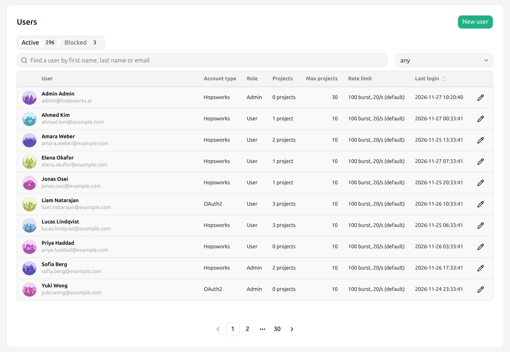
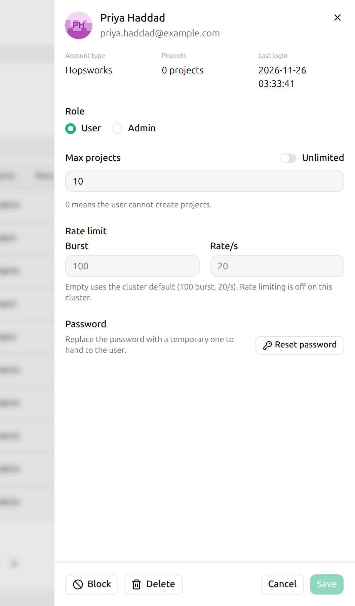
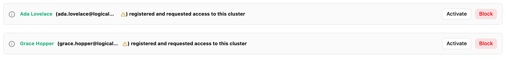
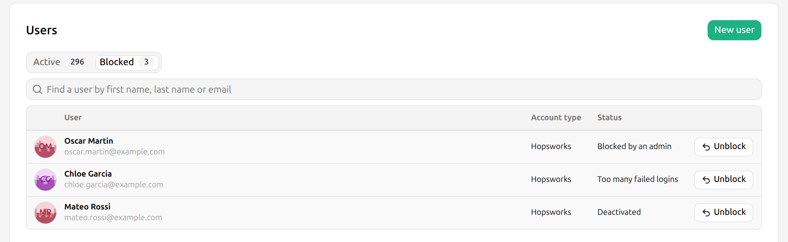
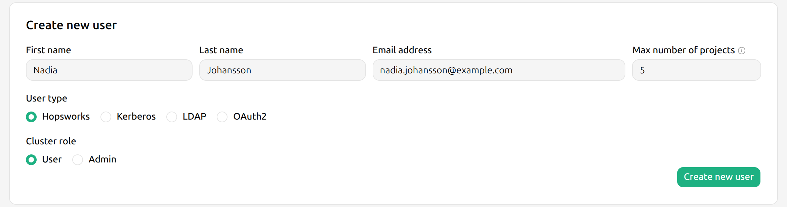
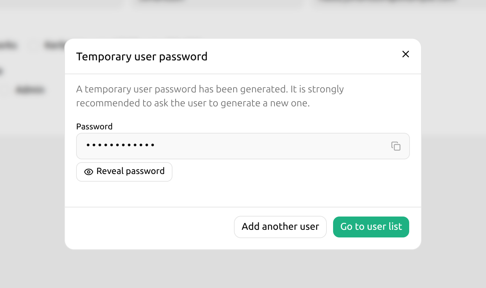
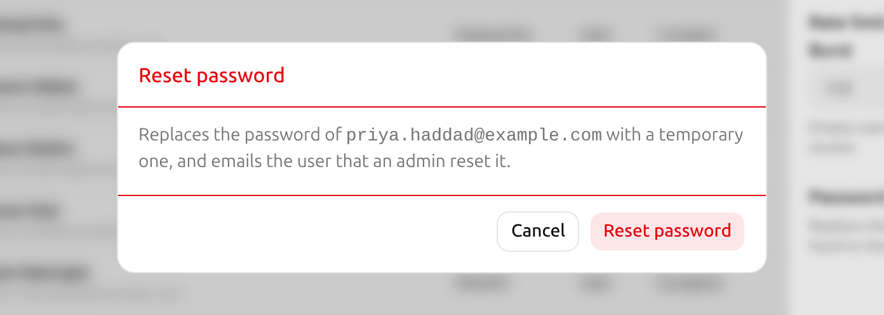
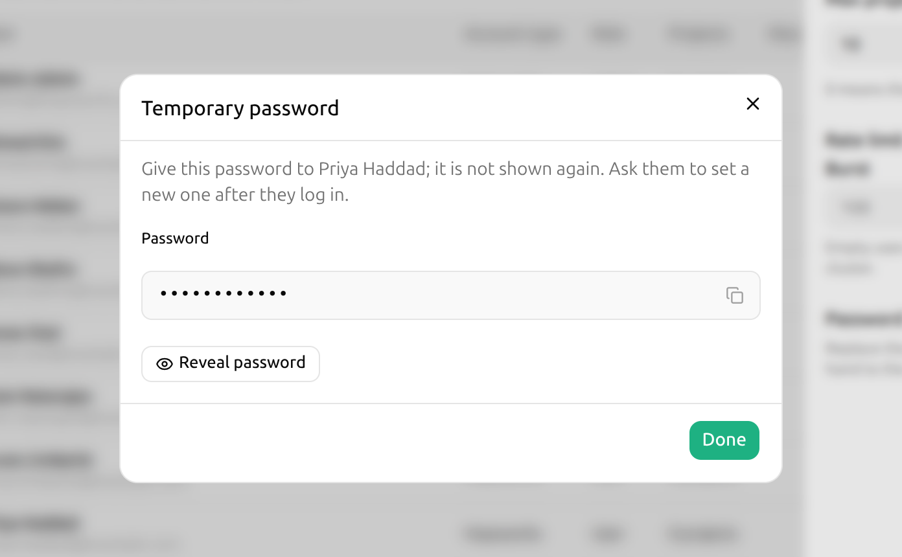
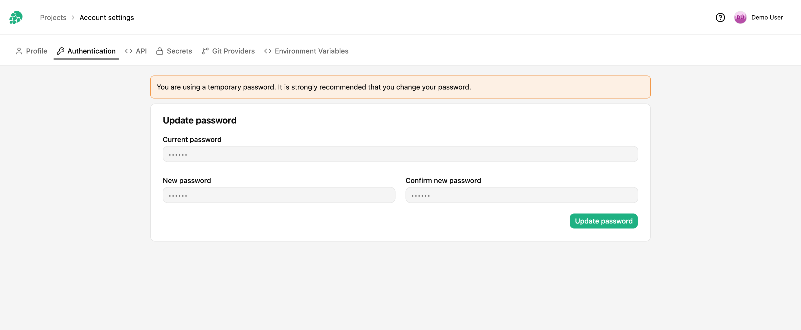

# User Management

## Introduction

Whether you run Hopsworks on-premise, or on the cloud using kubernetes, you have a Hopsworks cluster which contains all users and projects.

## Prerequisites

Administrator account on a Hopsworks cluster.

### Step 1: Go to user management

All the users of your Hopsworks instance have access to your cluster with different access rights.
You can find them by clicking on your name in the top right corner of the navigation bar, choosing _Cluster Settings_ from the dropdown menu, then choosing _Users_ under _Security & Access_ in the left sidebar (You need to have _Admin_ role to get access to the _Cluster Settings_ page).

<figure>
  
  <figcaption>Active Users</figcaption>
</figure>

The page has an _Active_ and a _Blocked_ tab, each showing how many users it holds.
Each row shows the user's account type, role, number of projects, project limit, rate limit and last login.

### Step 2: Edit a user

Roles let you manage the access rights of a user to the cluster.

- User: users with this role are only allowed to use the cluster by creating a limited number of projects.
- Admin: users with this role are allowed to manage the cluster.
  This includes accepting new users to the cluster or blocking them, managing user quota, [configure alerts](./alert.md) and setting up [authentication methods](./auth.md).

To change a user, click their row or the pencil icon at the end of it.
A side panel opens with the user's details.
Choose the role, set the maximum number of projects the user can create, or set their rate limit, then click _Save_.

- _Max projects_ takes a whole number, where 0 means the user cannot create projects; turn on _Unlimited_ to remove the limit.
- _Rate limit_ sets the user's API request burst and rate per second; leave both fields empty to use the cluster default.

You cannot change your own role.
The role of a user who signs in through OAuth2 is set through group mapping while `oauth_group_mapping_enabled` is on, and that of an LDAP or Kerberos user while `ldap_group_mapping_enabled` is on; with mapping off, their role is changed here like any other.

<figure>
  
  <figcaption>Edit a user</figcaption>
</figure>

### Step 3: Validating and blocking users

By default, a user who register on Hopsworks using their own credentials are not granted access to the cluster.
First, a user with an admin role needs to validate their account.

Users waiting for validation are listed at the top of the _Users_ page, above the search box, as shown in the image below.

<figure>
  
  <figcaption>Pending user requests</figcaption>
</figure>

Each pending row carries an _Activate_ and a _Block_ button.
A marker next to the email address shows that the address has not been validated yet.

Similarly, if a user is no longer allowed access to the cluster you can block them.
Open the user's side panel, click _Block_ and confirm.
A blocked user can no longer log in and moves to the _Blocked_ tab.

<figure>
  
  <figcaption>Blocked Users</figcaption>
</figure>

The _Blocked_ tab lists every blocked user with the reason, such as being blocked by an administrator or after too many failed logins.
If a user is blocked by mistake, click _Unblock_ in their row to give them access again.

A user who has no projects can also be deleted: open their side panel, click _Delete_ and type `confirm`.

If there are too many users in your cluster, use the search box (available for blocked users too) to filter users by name or email.
It is also possible to filter activated users by role.
For example to see all administrators in your cluster click on the _select dropdown_ to the right of the search box and choose _Admin_.

### Step 4: Create a new users

If you want to allow users to login without registering you can pre-create them by clicking on _New user_.

<figure>
  
  <figcaption>Create new user</figcaption>
</figure>

After setting the user's name and email chose the type of user you want to create (Hopsworks, Kerberos, LDAP or OAuth2).
To create a Kerberos or LDAP user you need to get the users **UUID** from the Kerberos or LDAP server.
_Max number of projects_ sets how many projects that user is allowed to create.
Hopsworks user can also be assigned a _Cluster role_.
Kerberos, LDAP and OAuth2 users on the other hand can only be assigned a role through group
mapping.

A temporary password will be generated and displayed when you click on _Create new user_.
Copy the password and pass it securely to the user.

<figure>
  
  <figcaption>Copy temporary password</figcaption>
</figure>

### Step 5: Reset user password

In the case where a user loses her/his password and can not recover it with the [password recovery](../../user_guides/projects/auth/recovery.md), an administrator can reset it for them.

Open the user's side panel, click _Reset password_ and confirm.
The password is replaced with a temporary one, and the user receives an email saying that an administrator reset it.
Only Hopsworks accounts have a password to reset: users who sign in through LDAP, Kerberos or OAuth2 use their directory's password.

<figure>
  
  <figcaption>Reset user password</figcaption>
</figure>

A temporary password will be displayed.
Copy the password and pass it to the user securely.

<figure>
  
  <figcaption>Copy temporary password</figcaption>
</figure>

A user with a temporary password will see a warning message when going to _Account settings_ **Authentication** tab.

<figure>
  
  <figcaption>Change password</figcaption>
</figure>

!!! Note

    A temporary password should be changed as soon as possible.

## Python SDK

!!! warning "Admin-only capability"
    The calling account must hold the `HOPS_ADMIN` platform role, since these calls manage users across the entire cluster.

Admin accounts can also manage platform users programmatically:

```python
import hopsworks


hopsworks.login()
users_api = hopsworks.get_users_api()

# Register a new user (a temporary password is generated if not provided)
new_user = users_api.register_user(
    email="alice@example.com",
    first_name="Alice",
    last_name="Smith",
    role="HOPS_USER",
)
if new_user.password:
    print("temporary password:", new_user.password)

# List / get users
for user in users_api.get_users():
    print(user.email, user.roles)
user = users_api.get_user(new_user.id)

# Activate / reject a registration request
users_api.activate_user(new_user.id)
users_api.reject_user(new_user.id)

# Change platform role or project quota
users_api.set_role(new_user.id, "HOPS_ADMIN")
users_api.update_user(new_user.id, max_num_projects=10)

# Delete a user (fails if they still own any projects)
users_api.delete_user(new_user.id)
```
