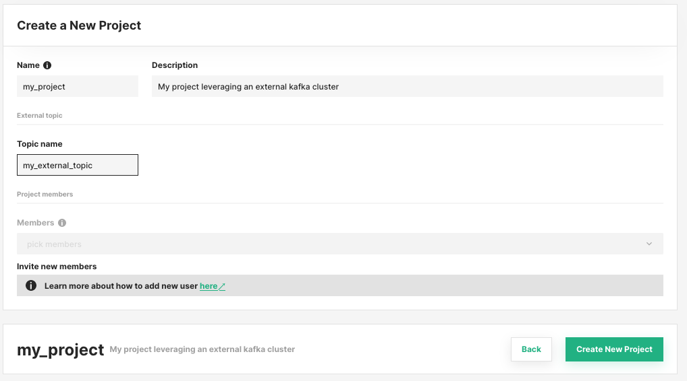

# External Kafka cluster

Hopsworks uses [Apache Kafka](https://kafka.apache.org/) to ingest data to the feature store.
Streaming applications and external clients send data to the Kafka cluster for ingestion to the online and offline feature store.
By default, Hopsworks comes with an embedded Kafka cluster managed by Hopsworks itself, however, users can configure Hopsworks to leverage an existing external cluster.
This guide will cover how to configure an Hopsworks cluster to leverage an external Kafka cluster.

!!! warning "Broker version requirement"
    Hopsworks 5.2 connects to Kafka with kafka-clients 4.3.1, which only speaks to brokers running Kafka 2.1 or newer ([KIP-896](https://cwiki.apache.org/confluence/display/KAFKA/KIP-896%3A+Remove+old+client+protocol+API+versions+in+Kafka+4.0)).
    An external cluster on an older broker version stops working after the upgrade to 5.2, so upgrade the brokers first.
    See the [Kafka 4 and KRaft upgrade notes][kafka4-client-compatibility].

## Configure the external Kafka cluster integration

To enable the integration with an external Kafka cluster, set the `enable_bring_your_own_kafka` [configuration option](../admin/variables.md) to `true`.
In the Helm values used to deploy Hopsworks:

```yaml
hopsworks:
  variables:
    enable_bring_your_own_kafka: "true"
```

### Online Feature Store service configuration

The Online Feature Store service (OnlineFS in short) consumes the feature store topics and writes them to the online feature store, so it needs to connect to the external Kafka cluster too.
Enter its connection in `Cluster Settings` → `OnlineFS` as Kafka client properties, with the brokers, the security protocol and the credentials, as described in [OnlineFS configuration][onlinefs-kafka-connection].
Enter the same Kafka cluster that the `kafka_connector` data sources of the projects use (see [Data Source configuration](#data-source-configuration)), because Hopsworks creates the topics there and the feature store clients write to it.
OnlineFS consumes from that one cluster only, so the online feature groups of a project without a `kafka_connector` data source, whose topics are on the embedded cluster, do not reach the online feature store.

Pointing OnlineFS at another Kafka cluster moves neither topics nor data.
Records left on the previous cluster are not ingested, and on the new cluster OnlineFS starts from the earliest records it retains, as described in [Consumer offsets][onlinefs-offsets].
A cluster that configured OnlineFS through the `onlinefs` Helm values keeps that configuration until a connection is saved in Cluster Settings.
Saving the same brokers there counts as a new cluster for the offsets, so OnlineFS reads the retained records again.

The principal of the connection needs Describe and Read on the topics OnlineFS consumes and on its consumer groups, and Write on the notification topics, as listed in [Permissions on the Kafka cluster][onlinefs-kafka-permissions].

OnlineFS subscribes to the topics matching `.*_onlinefs` by default.
To consume project topics that do not end in `_onlinefs`, widen the pattern in the [subscription][onlinefs-subscription], for example to `.*_onlinefs|my_project_topic`.
A topic list does not include the topics Hopsworks creates later, so their data would never reach the online feature store.

## Topics on the external Kafka cluster

Hopsworks creates and deletes the topics the feature store needs on the external cluster, as it does on its embedded cluster.
It connects with the `kafka_connector` data source of each project (see [Data Source configuration](#data-source-configuration)).
The Hopsworks pods call the brokers of that data source for every topic they create or look up, so the brokers must be reachable from the Hopsworks pods with its settings.

- Creating an online or stream feature group, changing a feature group's topic or notification topic, setting the project topic, or creating a topic through the Kafka topic API creates the topic when it does not exist yet.
- A stream feature group that is not online-enabled writes to a topic named after the project, with no suffix, unless the project or the feature group names a topic, so take that name into account when granting permissions by topic prefix.
- A topic that already exists is used as it is, and Hopsworks never deletes it.
- A topic Hopsworks created is deleted with its feature group or project, or when its feature group moves to another topic or notification topic, unless another project used the same topic name when it was created, in which case it is left in place.
  A feature group's topic also stays while another feature group still writes to it or sends its notifications to it.
- A topic Hopsworks created belongs to its project, so other projects cannot use it as their online or notification topic, because deleting that project would delete it.
  Topics Hopsworks did not create can be shared between projects.
- Topics and schemas are changed only through a project's own feature store: through a feature store shared from another project, the change is refused, because it would be made in that project and on its cluster.
- A project without a `kafka_connector` data source has its topics created on the embedded cluster, and Hopsworks deletes them there later, also after the data source is added.
  Create the data source before the project's first feature group so that its topics are created on the external cluster.

!!! warning "Topics are deleted by name"
    When Hopsworks deletes a topic it created on an external cluster, it deletes it on the cluster the project's `kafka_connector` points at then, which may differ from the cluster it was created on.
    Pointing a `kafka_connector` at another cluster while the project still has topics Hopsworks created there makes Hopsworks delete the topics of the same names on the new cluster, so delete those topics, or the project, first.

The principal of the `kafka_connector` data source needs the following permissions on the topics of its project:

| Permission | Needed for |
| --- | --- |
| Describe | Checking whether a topic exists. Producing to a topic needs it too. |
| Write | Producing to the topics. The feature store clients take their producer configuration from this data source, so without it inserts fail with an authorization error. |
| Read | Reading the topics. The offline materialization job reads the ingested rows from the topics with this data source. |
| Read on the consumer groups starting with `spark-kafka-relation-` | The offline materialization job reads the topics with Spark, which joins consumer groups of that prefix. |
| Create | Creating topics that do not exist yet. Without it, the operations that create a topic fail with the broker's reason. |
| Delete | Deleting the topics Hopsworks created. Without it, a topic stays on the cluster and in the project's topic list. |

Hopsworks records the topics it creates by name only, so the name of a topic it creates must be unique across the Hopsworks cluster, even when projects connect to different external clusters.

The project topic and the online and stream feature group topics get `onlinefs_service_thread_number` partitions, by default 10, and `kafka_num_replicas` replicas, by default 1.
Topics created through the Kafka topic API get the partitions and replicas they ask for.
Where `min.insync.replicas` is above a topic's replicas, producers that write with `acks=all` fail with `NotEnoughReplicas`, so set `kafka_num_replicas` to the replication factor of the external cluster:

```yaml
hopsworks:
  variables:
    kafka_num_replicas: "3"
```

The variable applies to every project, also to a project without a `kafka_connector` data source, whose topics are created on the embedded cluster, which refuses more replicas than it has brokers.

!!! note "No inference logging to an external Kafka"
    The inference logger of model deployments can only reach the embedded Kafka cluster.
    With an external Kafka cluster, a deployment created with inference logging gets no topic, and selecting an existing topic for it is refused.

## Project configuration

### Topic configuration

When creating a project, users can provide the topic name to use for the feature store operations.
Hopsworks creates the topic on the external cluster with the first feature group that writes to it, or when the topic is changed later, if it does not exist yet.
The topic can be changed later from `Project Settings` → `Kafka`, and individual feature groups can override it, as described in the [ingestion topic][feature-group-ingestion-topic] guide.

<p align="center">
  <figure>
    
    <figcaption>Example project creation when using an external Kafka cluster</figcaption>
  </figure>
</p>

### Data Source configuration

Users should create a [Kafka Data Source](../../user_guides/fs/data_source/creation/kafka.md) named `kafka_connector`.
Hopsworks uses it to create and delete the project's topics, and the feature store clients use it to configure the Kafka producers that send data.
The configuration is done for each project to ensure its members have the necessary authentication/authorization.
If the data source is not found in the project, default values referring to Hopsworks managed Kafka will be used.

Producers and consumers of your own get the same configuration from the data source, as described in the [Data Source usage guide](../../user_guides/fs/data_source/usage.md#streaming-based-connector).
