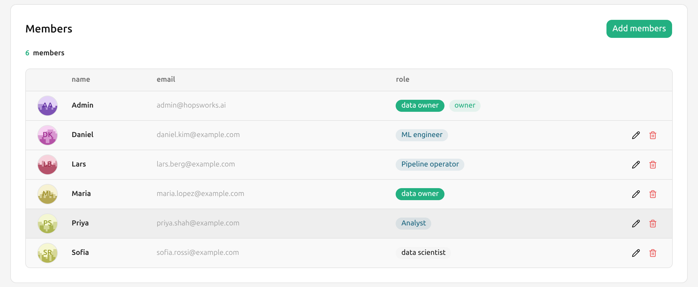
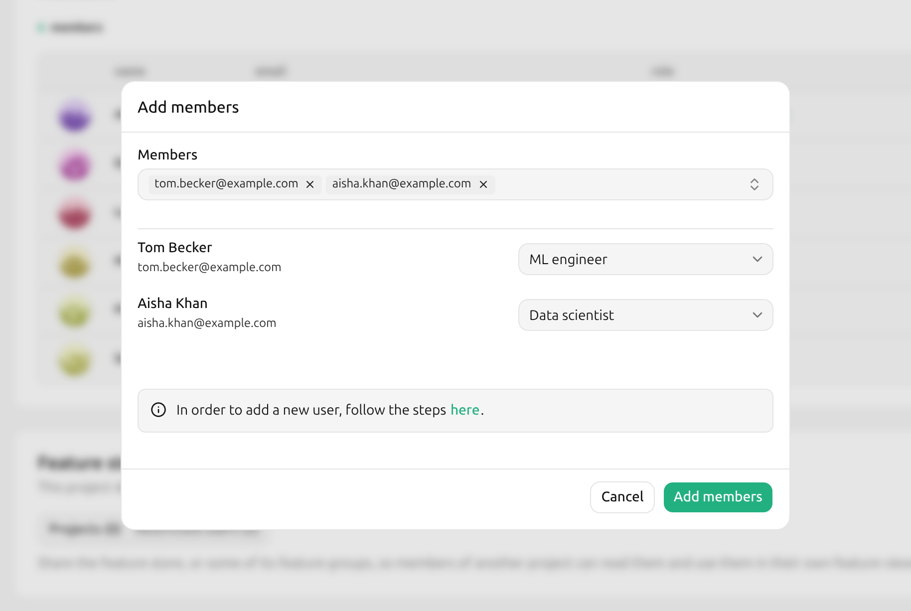
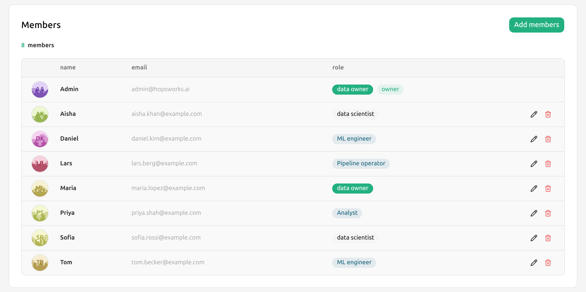
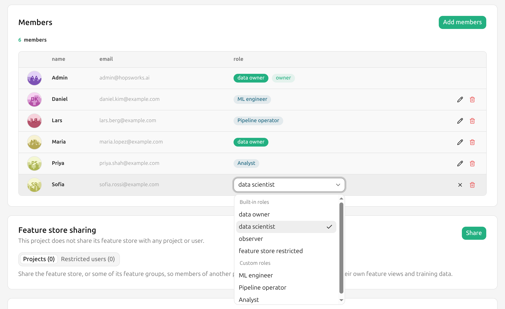

# How To Manage Members To A Project

## Introduction

In this guide, you will learn how to add new members to your project and understand the different roles available within a project.

## Step 1: View the members list

Navigate to the `Project settings` page and locate the `General` section, which displays the current members of the project.

<p align="center">
  <figure>
    
    <figcaption>List of project members</figcaption>
  </figure>
</p>

## Step 2: Add a new member

Click `Add members` to open a dialog where you can invite users. Select one or more users to invite.

<p align="center">
  <figure>
    
    <figcaption>Add new member dialog</figcaption>
  </figure>
</p>

Each member is given one of the roles below, depending on the level of access they need.

### Data owner

Data owners hold the highest authority in the project, with full control over its contents.

They can:

- Share the project with other projects
- Manage project settings and members
- Create, read, update, and delete all feature store resources (feature groups, feature views, training datasets, etc.)

!!! note "Project owner"
    The project owner is a special type of Data owner, the user who created the project unless it has been transferred since.
    Only the owner can delete the project from its settings.
    A platform administrator deletes it from the Project management page instead, see [Force deleting a project][force-deleting-a-project].
    The owner's role cannot be changed and the owner cannot be removed, but they can hand the project to another Data owner, see [Transfer ownership][transfer-ownership].

### Data scientist

Data scientists are consumers and creators of feature views and training datasets.

They can:

- Create feature views and training datasets using existing feature groups
- Manage the feature views and training datasets they have created
- Read feature groups created by Data owners

### Feature store restricted

Feature store restricted users function similarly to Data scientists but with tighter restrictions on what data they can access.
They are designed for users who should only work with features that have been explicitly shared with them.

Key differences from Data scientist:

- **No cross-project feature store access:** A Feature store restricted user cannot use feature groups from a shared project.
  They can only work within the feature groups of their own project.
- **Explicit sharing required:** A Feature store restricted user can only see and use feature groups that have been explicitly shared with them individually, not all feature groups in their project.
- **Feature view access is gated by feature access:** A Feature store restricted user can only interact with a feature view if they have access to every feature group the feature view depends on.
  If even one underlying feature group has not been shared with them, they cannot use that feature view.

They can:

- Access and use feature groups that have been explicitly shared with them
- Create feature views and training datasets using only the features they have been granted access to

### Custom roles

A cluster administrator can define custom roles, each a Data owner or a Data scientist with some permissions removed, as described in [Custom Project Roles][custom-project-roles].
They are listed under _Custom roles_ in the role picker, and the members list shows a member's custom role by name, with its base role in the tooltip.
A member holding a custom role is refused what the role removed, with a message naming the permission.

You can give only roles that fit inside your own role, and change only members whose role fits inside your own.

## Step 3: Confirm member invitation

The invited user will now appear in the members list and will have immediate access to the project based on their assigned role.

<p align="center">
  <figure>
    
    <figcaption>List of project members</figcaption>
  </figure>
</p>

## Step 4: Manage members

To change a member's role, click the edit button (:material-pencil:) in their row and pick the new role.
To remove them from the project, click the delete button (:material-delete:) in their row.

<p align="center">
  <figure>
    
    <figcaption>Changing a member's role</figcaption>
  </figure>
</p>

### What happens to a removed member's files

Each member has a private home directory in the project, `/Projects/<project>/Users/<username>`, holding their notebooks, their SSH key and their agent configuration.

When a member is removed, that directory and everything under it is transferred to another data owner. The files keep their contents and their paths; only the owner changes. The removed member loses access, as they do to the rest of the project.

The directory keeps the name of the member who had it, since the paths do not change. The new owner finds it in the project's `Users` dataset under that name, next to their own home directory. Nobody else sees it: home directories stay private to whoever owns them.

Adding that member back to the project gives them a new, empty home directory. The files they left keep the data owner who took them over, and move to `Users/<data owner>/former-members/<member>` to free the path.

A hand-over runs in the background and is retried until it completes. If it is lost, which deleting the removed member's account before it runs does, the platform's periodic permissions check finds the directory and hands it to the longest-serving data owner instead of the one the removal chose.

The remove dialog asks which data owner takes them, and starts on the data owner who has been in the project the longest. Only data owners are offered: a data scientist cannot manage members, so files handed to one would be out of reach of the people who can. Service accounts are never chosen.

The transfer runs in the background. A member with a large home directory takes a moment to hand over, because every file and directory under it changes owner one at a time, and the removal does not wait for that to finish.

Two cases where nothing is transferred, and one where the removal is refused:

| Case | Result |
| --- | --- |
| The removal asks for the home directory to be deleted | The directory is deleted, so there is nothing to transfer |
| The member being removed has no home directory | Nothing to transfer |
| Removing the member would leave the project with no data owner | The removal is refused. Give another member the data owner role first |

## Transfer ownership

The project owner can hand the project to another Data owner of the project.
A member holding a custom role based on Data owner is not eligible until they are given the built-in Data owner role.
In the project settings, click `Transfer ownership` in the `Project ownership` section, choose the new owner, type `confirm` and click `Transfer ownership`.
The new owner takes over what is special about the owner: they can delete the project, and they cannot be removed or have their role changed.
The previous owner stays a Data owner, so the new owner can afterwards change their role or remove them like any other member.

If the transfer reports that not every follow-up step completed, the project already belongs to the new owner.
The new owner finishes the transfer by handing the project to themselves with the Python SDK below, or a platform administrator finishes it.

To hand the project to a member who is not a Data owner, give them the Data owner role first.
If the owner has left and cannot hand the project over, a platform administrator can transfer it, see [Transferring a project to a new owner][transferring-a-project-to-a-new-owner].

### Ownership and group mapping

When members are added to the project by an LDAP, OAuth or Hopsworks group mapping, the owner is the exception: losing the mapped group neither changes their role nor removes them.
The hand-over is available in such a project even though member management is not, since it changes no membership.

After a transfer the new owner is the exception instead, and the previous owner is an ordinary member again.
Group synchronization may then change their role or remove them, depending on their groups.
If their groups still map them to the project, removing them by hand is undone the next time the groups are synchronized.

## Python SDK

```python
import hopsworks


project = hopsworks.login()

# Add a member
project.add_member("alice@example.com", "Data scientist")

# Give a custom role
project.add_member("bob@example.com", "ML engineer")

# List members; custom_role is None for a built-in role
for member in project.get_members():
    print(member.email, member.role, member.custom_role)

# Change a member's role
project.get_members_api().update_role("alice@example.com", "Observer")

# Remove a member. Their files go to the longest-serving data owner
project.remove_member("alice@example.com")

# Name the data owner that takes over their files
project.remove_member("alice@example.com", new_file_owner="carol@example.com")

# Delete their files instead of handing them over
project.remove_member("alice@example.com", delete_home_dir=True)

# Hand the project to another data owner. Only the owner can do this
project.transfer_ownership("carol@example.com")
```

Roles are the same as in the UI: `Data owner`, `Data scientist`, `Observer`, `Feature store restricted`, and the custom roles of the cluster.
For a member holding a custom role, `role` is the base role and `custom_role` the custom role's name.
A data scientist removing a member can only remove themselves.
The project owner's role cannot be changed and the owner cannot be removed until they have transferred the project.
