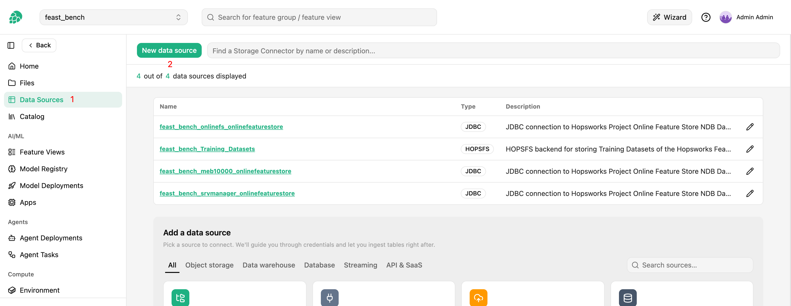

# How-To set up a Gmail Data Source { #data-source-gmail }

## Introduction

A Gmail data source is one Gmail or Google Workspace mailbox, read with the `https://www.googleapis.com/auth/gmail.readonly` scope.
It holds the mailbox address and its credentials: an OAuth client with a refresh token, or a Google Workspace service account with domain-wide delegation.

A Gmail data source is not browsed or mounted as an external feature group.
A sync job copies the mailbox into a Delta feature group, on demand, hourly or daily, and writes the attachments as files in the project.
You then read the emails like any feature group, or search them with DuckDB from a Hopsworks terminal.

## Prerequisites

You need the email address of the mailbox and one of the two kinds of credentials below.
Both are created in the [Google Cloud console](https://console.cloud.google.com/), in a Google Cloud project that has the [Gmail API](https://console.cloud.google.com/apis/library/gmail.googleapis.com) enabled.

### OAuth client and refresh token

Use this for a personal Gmail account, or for a Google Workspace mailbox whose owner grants access.

1. In the Google Cloud project, configure the OAuth consent screen.
2. Under `APIs & Services` > `Credentials`, create an `OAuth client ID` of type `Web application`.
    Add `https://developers.google.com/oauthplayground` as an authorized redirect URI, so that the OAuth 2.0 Playground can receive the authorization code.
    Note the **client ID** and the **client secret**.
3. Open the [OAuth 2.0 Playground](https://developers.google.com/oauthplayground).
    In its settings, check `Use your own OAuth credentials` and enter the client ID and the client secret.
    The refresh token is then issued to your client, which Hopsworks uses to renew it.
4. In `Step 1`, enter the scope `https://www.googleapis.com/auth/gmail.readonly` and nothing else, click `Authorize APIs`, and sign in as the owner of the mailbox.
5. In `Step 2`, click `Exchange authorization code for tokens` and copy the **refresh token**.

While the consent screen's publishing status is `Testing`, Google lets refresh tokens of external users expire after seven days.
Publish the consent screen, or use an `Internal` consent screen in Google Workspace, so that the sync jobs keep working.

### Google Workspace service account with domain-wide delegation

Use this for a mailbox in a Google Workspace domain that you administer.

1. In the Google Cloud project, under `IAM & Admin` > `Service accounts`, create a service account.
2. Under the service account's `Keys` tab, add a key of type JSON and download it.
3. Note the service account's unique **client ID**, shown on its details page.
4. In the Google Workspace Admin console, open `Security` > `Access and data control` > `API controls` > `Manage Domain Wide Delegation`.
    Add the client ID with the single scope `https://www.googleapis.com/auth/gmail.readonly`.
5. Upload the JSON key to the project, for example to the `Resources` dataset.
    Hopsworks stores the key's contents when you save the data source, so delete the file from the project afterwards.

!!! warning
    A service account with domain-wide delegation can read every mailbox in the domain, since it can impersonate any user.
    The data source reads only the mailbox it names, but anyone holding the key can read the others, so keep the key out of shared datasets and delete the uploaded file once the data source is saved.

## Creation in the UI

### Step 1: Set up new Data Source

Head to the `Data Sources` view on Hopsworks and click `New data source`.
The `Add a data source` catalog opens below.
Pick the `Gmail` card under `API & SaaS` to open the creation form.

<figure markdown>
  
  <figcaption>The Data Source View in the User Interface</figcaption>
</figure>

### Step 2: Enter the mailbox and credentials

Start by giving the data source a **name** and an optional **description**.

1. Enter the **Mailbox**, the email address to read.
2. Under **Authentication**, pick `OAuth client` or `Service account`.
3. For OAuth, enter the **Client ID**, the **Client secret** and the **Refresh token**.
    For a service account, pick or upload the JSON key in **Service account key file**.
4. Click `Test connection`.
    Hopsworks requests an access token with the credentials and reads the mailbox profile, and answers with the mailbox and its number of messages, such as `Connected to alice@example.com (1234 messages)`.
    When Google refuses the credentials, the error carries Google's reason, such as `invalid_grant` for a revoked or expired refresh token.
5. Save the data source.

## Creation with the Python SDK

```python
import hopsworks
from hsfs.storage_connector import GmailConnector


project = hopsworks.login()
fs = project.get_feature_store()

gmail = GmailConnector(
    id=None,
    name="support_inbox",
    featurestore_id=fs.id,
    mailbox="support@example.com",
    auth_type="OAUTH",
    client_id="1234567890-abc.apps.googleusercontent.com",
    client_secret="...",
    refresh_token="...",
)
gmail.save()
```

For a service account, pass `auth_type="SERVICE_ACCOUNT"` and `key_path` instead of the three OAuth arguments, with the HopsFS path of the uploaded key, such as `key_path="Resources/gmail-sa.json"`.

## Creation with the CLI

```bash
hops datasource create gmail support_inbox \
    --mailbox support@example.com --auth-type OAUTH \
    --client-id 1234567890-abc.apps.googleusercontent.com \
    --client-secret - --refresh-token - < secrets.txt
```

A secret option given as `-` reads one line from standard input, and each option also reads the environment variable `HOPSWORKS_DS_GMAIL_<OPTION>`, such as `HOPSWORKS_DS_GMAIL_REFRESH_TOKEN`, so secrets do not appear on the command line.
For a service account, use `--auth-type SERVICE_ACCOUNT --key-path Resources/gmail-sa.json`.

## Credentials

The credentials are write-only.
Hopsworks never returns the client secret, the refresh token or the service account key: reading the data source back returns `credentials_set`, the `client_id` for OAuth, and the `service_account_email` of the stored key.
When you edit the data source, leave a secret field empty to keep the stored value.
Switching between OAuth and a service account needs all the credentials of the new type.

To call the [Gmail API](https://developers.google.com/gmail/api/reference/rest) from your own code, ask the data source for a short-lived access token.
The token has the `gmail.readonly` scope and expires within an hour, so ask for a new one when it is about to expire.

```python
import hopsworks
import requests


project = hopsworks.login()
fs = project.get_feature_store()

gmail = fs.get_data_source("support_inbox").storage_connector
token = gmail.get_access_token()
labels = requests.get(
    f"https://gmail.googleapis.com/gmail/v1/users/{token.mailbox}/labels",
    headers={"Authorization": f"Bearer {token.token}"},
    timeout=60,
).json()
```

`token.expires_at` is the expiry in epoch milliseconds.

## Sync jobs

A sync job is a Python job, listed on the `Jobs` page, that copies the mailbox into a feature group.
It can run on demand, hourly at the top of every hour, or daily at 00:00 UTC, and you can run, schedule and monitor it like any other job.

### The feature group

The job upserts one row per email into a Delta feature group, version 1, that its first run creates.

- **Name:** by default, the mailbox's local part and the first label of its domain, lower case, with every run of other characters replaced by `_`, followed by `s`.
    `dowling.jim@gmail.com` becomes `dowling_jim_gmails` and `support@example.com` becomes `support_examples`.
    A name that would start with a digit is prefixed with `mail_`.
    You can set another name of lower case letters, digits and `_` that starts with a letter, at most 63 characters long.
- **Primary key:** `message_id`.
- **Event time:** `internal_date`, Gmail's `internalDate`: when Gmail accepted the message, or for mail imported into the mailbox, the sender's `Date`.
- **Partitions:** `day` (`YYYY-MM-DD`) of `internal_date` in UTC.
    New messages are added as new files, so an hourly job adds about one Parquet file to the current day every hour.
    The first run after a day ends in UTC compacts that day's files into files of up to 192 MiB, aiming at 100 to 250 MB.

| Column | Type | Content |
| --- | --- | --- |
| `message_id` | string | Gmail message id, the primary key |
| `thread_id` | string | Gmail thread id |
| `history_id` | string | Gmail history id |
| `internal_date` | timestamp | Gmail's `internalDate` in UTC, the event time |
| `day` | string | Receive date, `YYYY-MM-DD`, partition key |
| `hour` | string | Receive hour, `HH` |
| `date_header` | string | The raw `Date` header |
| `from_address` | string | The `From` header |
| `to_addresses` | array&lt;string&gt; | The `To` addresses |
| `cc_addresses` | array&lt;string&gt; | The `Cc` addresses |
| `bcc_addresses` | array&lt;string&gt; | The `Bcc` addresses |
| `subject` | string | The `Subject` header |
| `labels` | array&lt;string&gt; | Gmail label ids, such as `INBOX`, `SENT` or `Label_123` |
| `snippet` | string | Gmail's short preview of the message |
| `size_estimate` | bigint | Gmail's estimate of the message size in bytes |
| `body_text` | string | The plain text body, or the HTML body with its tags removed |
| `attachments` | array&lt;string&gt; | Full paths of the attachment files |

The headers are stored as `from_address`, `to_addresses` and `date_header` because `from`, `to` and `date` are SQL keywords.

### Attachments

Attachments are written as files under the sync job's attachments directory:

```text
<attachments directory>/day=YYYY-MM-DD/<message_id>/<filename>
```

The default attachments directory is `Resources/gmail/<feature group>`.
HopsFS file names are limited to Latin-1 characters, so a sync job replaces any other characters in an attachment's file name with `_` and shortens names longer than 200 bytes; a second attachment with the same name in a message gets a `-2` suffix.
It must be a directory inside a dataset, outside `Resources/jobs`, and not the dataset itself.
The `attachments` column lists the full paths of a message's files, such as `/Projects/myproject/Resources/gmail/support_examples/day=2026-10-24/18c2f0a1b2c3d4e5/invoice.pdf`.

### Loading strategies

- `INCREMENTAL_TIMESTAMP` (the default): the first run copies the mailbox from the start date on, or the whole mailbox without one.
    Every later run upserts only the messages Gmail received since the previous run, whatever their `internal_date`.
    The first run reads the mailbox a week at a time, oldest first, and upserts every 5000 messages, so the feature group fills while it runs and a run that fails resumes from its last upsert.
    The upserts are keyed by `message_id`, so a retried run, or a run that overlaps the previous one, never duplicates a message.
    The schedule starts no run while another run of the job is still copying, so an hourly job first runs once the backfill ends; a run started by hand meanwhile does nothing and succeeds.
    Gmail limits how many requests a user's mailbox serves per minute, so a backfill of tens of thousands of emails can take hours.
    A throttled run waits and retries until Gmail serves it again, and never fails because of throttling; the job log reports how often Gmail throttled it.
- `FULL_LOAD`: every run copies all the selected messages from the start date on, overwrites the feature group, and rebuilds the attachments directory.
    A run that selects no messages leaves the feature group as it was.

The feature group is an archive of the mailbox:

- An incremental run does not remove the messages deleted in Gmail, and does not follow label changes; a full load does.
- Spam, trash and drafts are not copied.
- A message whose headers or body cannot be parsed is left out, and the job log names its Gmail message id.
- Messages received in the last minute are left to the next run, since Gmail can still be indexing them.
- A message that is imported into the mailbox later with an older receive time, such as mail migrated from another account, falls before the incremental cursor and is copied only by a full load.
- An incremental run refuses a feature group that was filled for a different mailbox, query or labels.
    After changing the query or the labels, run a full load, or sync into a new feature group.

Two sync jobs, of Gmail or [Outlook][data-source-outlook] data sources, cannot write the same feature group, nor attachment directories that overlap, since their runs would overwrite each other's rows and files.

### Configure a sync job in the UI

Open the data source from the `Data Sources` view.
Its `Sync jobs` card lists the sync jobs with their feature group, attachments directory, mailbox and schedule, and a DuckDB query to copy into a terminal.
Click `Configure sync job` to create one, or the pencil icon of a sync job to edit it.

1. **Job name:** defaults to `<data source name>_gmail_sync`.
2. **Feature group:** leave it empty for the default name derived from the mailbox.
3. **Attachments directory:** leave it empty for `Resources/gmail/<feature group>`, or pick a directory.
4. **Search query:** optional, a [Gmail search query](https://support.google.com/mail/answer/7190) written as in the Gmail search box, such as `from:billing@example.com has:attachment`.
5. **Mailboxes:** optional, the labels to sync, such as Inbox or Sent, picked from the mailbox's labels; a message carrying any of the checked labels is copied.
    With none checked, every message except spam, trash and drafts is copied.
6. **Loading strategy:** `Incremental` or `Full load (backfill)`, and an optional **Start date**: only emails received on or after it are copied.
7. **Environment:** the Python environment of the job; left empty, a new job runs in `python-feature-pipeline`.
8. **Schedule:** `None`, `Hourly` or `Daily` (00:00 UTC).
9. Check `Start after creation` to run the job when it is saved.

The feature group in the card links to the feature group once the first run has created it.

### Configure a sync job with the Python SDK

```python
import hopsworks


project = hopsworks.login()
fs = project.get_feature_store()

gmail = fs.get_data_source("support_inbox").storage_connector
job = gmail.sync(
    feature_group_name=None,
    attachments_path=None,
    query="-category:promotions",
    labels=["INBOX"],
    loading_strategy="INCREMENTAL_TIMESTAMP",
    initial_value="2026-01-01",
    schedule="hourly",
    job_name=None,
    environment=None,
    start=True,
)
```

- `feature_group_name`: defaults to the name derived from the mailbox.
- `attachments_path`: defaults to `Resources/gmail/<feature group>`.
- `query`, `labels`: select the messages, as in the UI; `labels` takes label ids, which `get_labels()` lists by name.
- `loading_strategy`: `INCREMENTAL_TIMESTAMP` or `FULL_LOAD`.
- `initial_value`: the earliest receive time to copy, as a date or datetime, a date string, or epoch milliseconds.
- `schedule`: `hourly`, `daily`, or `None` to leave the job's schedule as it is.
- `job_name`: defaults to `<data source name>_gmail_sync`.
- `environment`: the Python environment; a new job defaults to `python-feature-pipeline`.
- `start`: whether to start a run now, without waiting for it.

`sync` returns the job.
Calling it again with the same `job_name` updates the job.
`DataSource.sync` takes the same arguments, so `fs.get_data_source("support_inbox").sync(schedule="daily")` does the same.

The data source lists, reads and deletes its sync jobs:

```python
import hopsworks


project = hopsworks.login()
fs = project.get_feature_store()

gmail = fs.get_data_source("support_inbox").storage_connector
for config in gmail.list_sync_jobs():
    print(config.job_name, config.feature_group_name, config.path)

config = gmail.get_sync_job("support_inbox_gmail_sync")
gmail.delete_sync_job("support_inbox_gmail_sync")
```

Deleting a sync job deletes the job and its schedule; the feature group and the attachment files stay.

### Configure a sync job with the CLI

```bash
hops datasource labels support_inbox
hops datasource sync support_inbox --start-date 2026-01-01 --label INBOX --schedule hourly
hops datasource sync-jobs support_inbox
```

`hops datasource sync` takes `--feature-group`, `--attachments-path`, `--query`, `--label` (repeatable), `--strategy`, `--start-date`, `--schedule`, `--job-name`, `--environment` and `--start/--no-start`, with the defaults of the Python SDK.
`hops datasource labels` lists the ids and names of the mailbox's labels, for `--label`.
`hops datasource sync-jobs` lists each sync job with its feature group, attachments directory and loading strategy.

!!! api "API reference"

    - <code class="doc-symbol doc-symbol-method"></code> [`FeatureStore.get_data_source`][hsfs.feature_store.FeatureStore.get_data_source]
    - <code class="doc-symbol doc-symbol-class"></code> [`DataSource`][hsfs.core.data_source.DataSource]
        - <code class="doc-symbol doc-symbol-method"></code> [`sync`][hsfs.core.data_source.DataSource.sync]
    - <code class="doc-symbol doc-symbol-class"></code> [`GmailConnector`][hsfs.storage_connector.GmailConnector]
        - <code class="doc-symbol doc-symbol-method"></code> [`get_access_token`][hsfs.storage_connector.GmailConnector.get_access_token]
        - <code class="doc-symbol doc-symbol-method"></code> [`sync`][hsfs.storage_connector.GmailConnector.sync]
        - <code class="doc-symbol doc-symbol-method"></code> [`list_sync_jobs`][hsfs.storage_connector.GmailConnector.list_sync_jobs]
        - <code class="doc-symbol doc-symbol-method"></code> [`get_sync_job`][hsfs.storage_connector.GmailConnector.get_sync_job]
        - <code class="doc-symbol doc-symbol-method"></code> [`delete_sync_job`][hsfs.storage_connector.GmailConnector.delete_sync_job]
    - <code class="doc-symbol doc-symbol-class"></code> [`MailSyncJobConfig`][hsfs.storage_connector.MailSyncJobConfig]

    <a class="hops-api-cta" href="../../../../../python-api/hopsworks/">Browse the full Python API :material-arrow-right:</a>

## Read the emails

Read the feature group like any other:

```python
import hopsworks


project = hopsworks.login()
fs = project.get_feature_store()

emails = fs.get_feature_group("support_examples", version=1).read()
```

### Search with DuckDB in a terminal

Hopsworks terminals ship the DuckDB 2.0 command-line interface with its `delta` and `fts` extensions preinstalled, so they load without internet access.
`-init /opt/duckdb/init.sql` loads them.
DuckDB reads the feature group's Delta table in place, at `/hopsfs/featurestore/<project>_featurestore.db/<feature group>_1` with the project name in lower case.

```bash
T=/hopsfs/featurestore/myproject_featurestore.db/support_examples_1
duckdb -init /opt/duckdb/init.sql -c "
SELECT message_id, internal_date, from_address, subject
FROM delta_scan('$T')
WHERE day >= '2026-10-18' AND subject ILIKE '%invoice%'
ORDER BY internal_date DESC LIMIT 20;"
```

The DuckDB Python package in the terminal reads the table the same way after `SET extension_directories = ['/opt/duckdb/extensions']; LOAD delta;`.

- Filter on `day` first: DuckDB then reads only those partitions. Add `hour` for a time of day.
- Select the columns you need, and read `body_text`, the largest column, only for rows already narrowed down.
- Read the table with `delta_scan`, never with `read_parquet` over its directory: Delta keeps the files that upserts superseded, so `read_parquet` returns the same email more than once.
- An attachment path `/Projects/<project>/<path>` is at `/hopsfs/<path>` in the terminal.

Claude and the other coding agents in a terminal load the `hops-email-search` skill for questions about the mailbox; it finds the table and shapes the queries this way.

## Delete the data source

Deleting a Gmail data source deletes its sync jobs and their schedules.
The feature groups and the attachment files stay.
