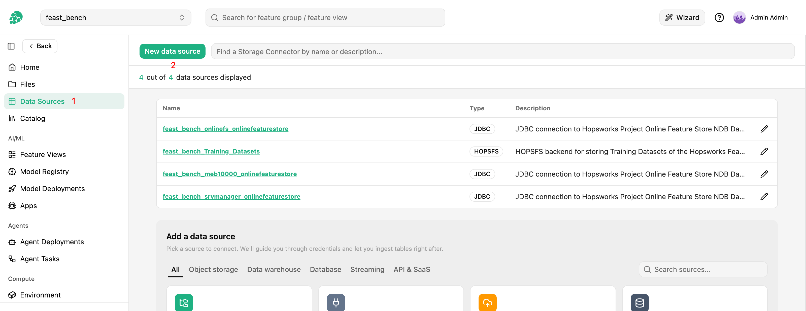

# How-To set up a Google Drive Data Source { #data-source-google-drive }

## Introduction

A Google Drive data source connects a Hopsworks project to a folder in [Google Drive](https://www.google.com/drive/), in a user's My Drive or in a shared drive.
It does not back feature groups and cannot be read with Spark.
Instead, it is the source of a [files ingestion job][files-ingestion], which copies the files under the folder, whatever their format, into a dataset of the project, either once or on a schedule, with optional mirroring of deletions and a file index feature group.

Hopsworks reads the folder as a Google Cloud service account, through the Google Drive API with the read-only scope `drive.readonly`, with the dltHub `filesystem` source in read-only mode.
Data only flows from Google Drive into Hopsworks.
Changes made in the dataset are never written back to Drive.

## Prerequisites

### Service account and key file

Hopsworks authenticates to Google Drive with a service account of a Google Cloud project:

1. In the [Google Cloud console](https://console.cloud.google.com/), pick or create a project and [enable the Google Drive API](https://console.cloud.google.com/apis/library/drive.googleapis.com) in it.
   Requests of a project without the API enabled are refused, whatever the folder is shared with.
2. Under `IAM & Admin`, then `Service Accounts`, create a service account.
   It needs no role in the Google Cloud project; its access to the files comes from sharing the folder with it.
3. Open the service account, and under `Keys` add a new key of type `JSON`.
   Download the key file; it is the only copy.
   See [Create service account keys](https://cloud.google.com/iam/docs/keys-create-delete) for the details.
4. Note the service account's email, `<name>@<project>.iam.gserviceaccount.com`, which is also the `client_email` field of the key file.

The key file is uploaded to the Hopsworks project when the data source is created, and deleted with it.

### Folder

Share the folder with the service account's email, as a `Viewer`.
Hopsworks only lists and downloads, so viewer access is enough.

For a shared drive, add the service account as a member of the shared drive, as a `Viewer`, or share one of its folders with it.
Shared drives are reached through the same data source; nothing else is needed.

Copy the **folder ID** from the folder's URL in the browser: it is the last part of `https://drive.google.com/drive/folders/<folder ID>`, a string of letters, digits, `-` and `_`.
The root of a shared drive has an ID of the same form, in the URL of the shared drive.
The data source stores the ID, since folder names are neither unique nor stable; the folder name entered next to it is only shown in the UI.

### Client version

The Python client and the `hops` CLI support Google Drive data sources from Hopsworks 5.3.0.
Clients older than 5.3.0 do not know the Google Drive type and fail to list a feature store's data sources once it has one, so upgrade the client in environments that list data sources.

## Creation in the UI

### Step 1: Set up a new data source

Head to the `Data Sources` view in Hopsworks and click `New data source`.
Pick the `Google Drive` card, in the `Files & documents` category.

<figure markdown>
  
  <figcaption>The Data Source view in the user interface</figcaption>
</figure>

### Step 2: Enter the folder and the key file

<!-- TODO screenshot google_drive_creation.png to capture; uncomment once the file exists:
<figure markdown>
  
  <figcaption>The Google Drive creation form</figcaption>
</figure>
-->

1. **Name** and an optional **Description**.
2. **Service account key file**: upload the JSON key file from your machine with `Upload new file`, or pick one already in the project with `From Project`.
3. **Folder ID**: the ID copied from the folder's URL.
4. **Folder name**: an optional label shown next to the ID in the UI; it is not used to find the folder.

Click `Test connection` to check the key file.
Hopsworks reads it from the project and checks that it is a service account key, with a `client_email` and a `private_key`, and answers with the service account's email and a reminder to share the folder with it, such as `Service account ingest@acme.iam.gserviceaccount.com; share folder 1AbCdEfGhIjKlMnOpQrStUvWxYz with it`.
The test does not call Google Drive, so a folder that is not shared with the service account, or a project without the Drive API enabled, is only found by the first run of a files ingestion job.

Click `Next` to save the data source and go on to the second step of the wizard, `Copy files into a dataset`, described in the [files ingestion guide][files-ingestion].
The `Browse` button of the prefix is not available for Google Drive, so type the prefix.

### Editing the data source

The data source page shows the folder ID, the folder name, the key file path and the service account's email read from the key.
Pick another key file to rotate the credentials; the next run of each files ingestion job uses it.

## Using the Python client

The key file must be in the project before the data source is created; upload it with the dataset API.

```python
import hopsworks
from hsfs.storage_connector import GoogleDriveConnector


project = hopsworks.login()
fs = project.get_feature_store()

key_path = project.get_dataset_api().upload("drive-sa.json", "Resources")

drive = fs.create_data_source(
    GoogleDriveConnector(
        id=None,
        name="handbook_drive",
        featurestore_id=fs.id,
        key_path=key_path,
        folder_id="1AbCdEfGhIjKlMnOpQrStUvWxYz",
        folder_name="Handbook",
    )
).storage_connector

print(drive.service_account_email)  # from the key file; share the folder with it

job = drive.ingest_files(dataset="handbook", prefix="2026/")
```

`key_path` is the path of the key file in the project, as returned by `upload`, or written out as `/Projects/<project>/Resources/drive-sa.json`.
`service_account_email` is read-only and filled by Hopsworks from the key file.

!!! api "API reference"

    - <code class="doc-symbol doc-symbol-method"></code> [`FeatureStore.create_data_source`][hsfs.feature_store.FeatureStore.create_data_source]
    - <code class="doc-symbol doc-symbol-method"></code> [`FeatureStore.get_data_source`][hsfs.feature_store.FeatureStore.get_data_source]
    - <code class="doc-symbol doc-symbol-method"></code> [`DatasetApi.upload`][hopsworks_common.core.dataset_api.DatasetApi.upload]
    - <code class="doc-symbol doc-symbol-class"></code> <autoref identifier="hsfs.storage_connector.GoogleDriveConnector" optional><code>GoogleDriveConnector</code></autoref>
    - <code class="doc-symbol doc-symbol-class"></code> [`StorageConnector`][hsfs.storage_connector.StorageConnector]
        - <code class="doc-symbol doc-symbol-method"></code> <autoref identifier="hsfs.storage_connector.StorageConnector.ingest_files" optional><code>ingest_files</code></autoref>
    - <code class="doc-symbol doc-symbol-docs"></code> [Google Drive API](https://developers.google.com/workspace/drive/api/guides/about-sdk)

    <a class="hops-api-cta" href="../../../../../python-api/hopsworks/">Browse the full Python API :material-arrow-right:</a>

## Using the CLI

```bash
hops datasource create google-drive handbook_drive \
    --key-file ./drive-sa.json \
    --folder-id 1AbCdEfGhIjKlMnOpQrStUvWxYz --folder-name Handbook
hops datasource ingest-files handbook_drive --dataset handbook --prefix 2026/
```

`--key-file` is the key file on your machine; the command checks that it is a service account key, uploads it to `Resources/datasources/<name>/` in the project and registers the data source with that path.
For a key already in the project, pass its full HopsFS path with `--key-path` instead.

## Next steps

Copy the files under the folder into a dataset with a [files ingestion job][files-ingestion].
The prefix of the job is a folder path below the shared folder, by folder names, and a run reads `gdrive://<folder ID>/<prefix>`, so an empty prefix copies the whole shared folder.
The index feature group, when turned on, records `gdrive` in `source_type` and the same `gdrive://` URL in `source_url`.

## Limitations

- A Google Drive data source is read-only and files-only.
  It backs no feature groups, cannot be read with Spark, and the dltHub table ingestion does not offer it.
- Only files stored in Drive are copied.
  Google Docs, Sheets, Slides and the other Google-native documents have no file content to download; the Drive API refuses to download them and the job does not export them, so they are listed, fail to copy, are reported as `failed` and end every run as `partial`.
  Exclude them with an exclude pattern on their names, or keep them in a folder outside the prefix.
- Files are copied one at a time and the folder tree is listed in full on every run, so a very large folder is better split into several jobs with narrower prefixes.
- Browsing the folder for a prefix is not available; type the prefix, as a path of folder names.
- `Test connection` only checks the key file; sharing and the Drive API are checked by the first run.
