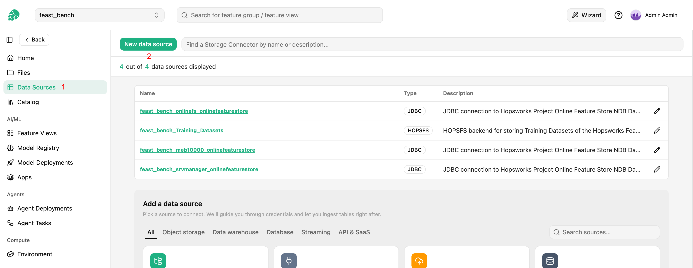

# How-To set up a Google Sheets Data Source { #data-source-google-sheets }

## Introduction

A Google Sheets data source reads the tabs of a Google spreadsheet with a Google Cloud service account.
It holds the path of the service account's JSON key file in the project and, optionally, the ID of one spreadsheet.

A spreadsheet tab is not mounted as an external feature group.
A [dltHub ingestion job][ingest-data-with-dlthub] copies each tab you select into its own managed feature group, on demand or on a schedule.

## Prerequisites

You need a Google Cloud service account that can read the spreadsheet, and its JSON key.

1. In the [Google Cloud console](https://console.cloud.google.com/), enable the [Google Sheets API](https://console.cloud.google.com/apis/library/sheets.googleapis.com) in a Google Cloud project.
2. Under `IAM & Admin` > `Service accounts`, create a service account in that project.
    It needs no IAM role.
3. Under the service account's `Keys` tab, add a key of type JSON and download it.
4. In Google Sheets, share the spreadsheet with the service account's email address, such as `sheets-reader@my-project.iam.gserviceaccount.com`, as a `Viewer`.
    Hopsworks only reads the spreadsheet, with the `https://www.googleapis.com/auth/spreadsheets.readonly` scope.
5. Note the **spreadsheet ID**, the part of the spreadsheet's URL between `/d/` and the next `/`.
    In `https://docs.google.com/spreadsheets/d/1BxiMVs0XRA5nFMdKvBdBZjgmUUqptlbs74OgvE2upms/edit`, the ID is `1BxiMVs0XRA5nFMdKvBdBZjgmUUqptlbs74OgvE2upms`.

The ingestion job takes the first row of a tab as the column names, so give every tab you ingest a header row.
See the [dltHub Google Sheets documentation](https://dlthub.com/docs/dlt-ecosystem/verified-sources/google_sheets) for how the cells are read.

!!! warning "Keep the key file in the project"
    The data source stores the path of the key file, not its contents.
    Hopsworks reads the file every time it lists the tabs, fetches a schema or runs an ingestion job, so do not move or delete the file while the data source is in use.
    Anyone who can read the file can read every spreadsheet shared with the service account.

## Creation in the UI

### Step 1: Set up new Data Source

Head to the `Data Sources` view on Hopsworks and click `New data source`.
The `Add a data source` catalog opens below.
Pick the `Google Sheets` card under `API & SaaS` to open the creation form.

<figure markdown>
  
  <figcaption>The Data Source View in the User Interface</figcaption>
</figure>

### Step 2: Enter the key file and the spreadsheet

Start by giving the data source a **name** and an optional **description**.

1. Under **Authentication JSON Keyfile**, pick the key file from the project or upload it.
    An uploaded key is stored in the `storage_connector_resources` directory of the project's feature store.
2. Optionally enter the **Spreadsheet Id**.
    Leave it empty to use the data source for several spreadsheets, and enter the ID for each feature group instead.
3. Save the data source.

A spreadsheet ID set on the data source applies to all its feature groups: a feature group cannot name another spreadsheet.

## Creation with the Python SDK

Upload the key file to the project first, for example to the `Resources` dataset.

```python
import hopsworks
from hsfs.storage_connector import GoogleSheetsConnector


project = hopsworks.login()
fs = project.get_feature_store()

project.get_dataset_api().upload("sheets-key.json", "Resources")

sheets = GoogleSheetsConnector(
    id=None,
    name="finance_sheets",
    featurestore_id=fs.id,
    key_path=f"/Projects/{project.name}/Resources/sheets-key.json",
    spreadsheet_id="1BxiMVs0XRA5nFMdKvBdBZjgmUUqptlbs74OgvE2upms",
)
sheets.save()
```

`spreadsheet_id` is optional, as in the UI.

## Creation with the CLI

```bash
hops datasource create google-sheets finance_sheets \
    --key-path /Projects/myproject/Resources/sheets-key.json \
    --spreadsheet-id 1BxiMVs0XRA5nFMdKvBdBZjgmUUqptlbs74OgvE2upms
```

`--key-path` is the full HopsFS path of the uploaded key file, and `--spreadsheet-id` is optional.

## Ingest tabs into feature groups

Each feature group copies one tab of the spreadsheet.
The tab is named by `DataSource.table`, and the spreadsheet by the data source or, when the data source has no spreadsheet ID, by `DataSource.spreadsheet_id`.
Google Sheets tabs are always copied with a full load: every run replaces the rows of the feature group with the current content of the tab.

### In the UI

1. Open the data source from the `Data Sources` view and continue to the resource selection.
2. If the data source has no spreadsheet ID, enter the **Spreadsheet Id**.
3. Click `Discover sheets` to list the tabs of the spreadsheet, and select the tabs to ingest.
4. For each selected tab, fetch the schema and set the feature group name, the features and the primary key.
    Hopsworks infers the schema from a small sample of the tab's rows.
5. Configure the ingestion job as described in [Ingest Data with dltHub][ingest-data-with-dlthub].

When Google refuses the request, the error carries Google's message.
An HTTP 403 means that the spreadsheet is not shared with the service account, or that the Google Sheets API is not enabled in the service account's Google Cloud project.

### With the Python SDK

`get_tables()` lists the tabs of the data source's spreadsheet, and `get_data()` returns the inferred schema and a preview of one tab.

```python
import hopsworks
from hsfs.core.data_source import DataSource


project = hopsworks.login()
fs = project.get_feature_store()

sheets = fs.get_data_source("finance_sheets").storage_connector
for tab in sheets.get_tables():
    print(tab.table)

fg = fs.create_feature_group(
    name="budget_actuals",
    version=1,
    primary_key=["id"],
    data_source=DataSource(storage_connector=sheets, table="Q1 Actuals"),
    sink_enabled=True,
)
fg.save()
fg.sink_job.run()
```

For a data source without a spreadsheet ID, pass `spreadsheet_id` to the `DataSource`.
`get_tables()` needs the spreadsheet ID on the data source.

To copy several tabs, create one ingestion job for all of them instead of one job per tab:

```python
import hopsworks
from hsfs.core.data_source import DataSource


project = hopsworks.login()
fs = project.get_feature_store()

data_source = fs.get_data_source("finance_sheets")
sheets = data_source.storage_connector
job = data_source.new_ingestion_job(name="finance_sheets_ingest", table_parallelism=2)

for tab, name in [("Q1 Actuals", "budget_actuals"), ("Q1 Plan", "budget_plan")]:
    fs.get_or_create_feature_group(
        name=name,
        version=1,
        primary_key=["id"],
        data_source=DataSource(storage_connector=sheets, table=tab),
        sink_enabled=True,
        sink_job=job,
    ).save()

job.save()
job.run()
```

!!! api "API reference"

    - <code class="doc-symbol doc-symbol-method"></code> [`FeatureStore.get_data_source`][hsfs.feature_store.FeatureStore.get_data_source]
    - <code class="doc-symbol doc-symbol-class"></code> [`DataSource`][hsfs.core.data_source.DataSource]
    - <code class="doc-symbol doc-symbol-class"></code> <autoref identifier="hsfs.storage_connector.GoogleSheetsConnector" optional><code>GoogleSheetsConnector</code></autoref>

    <a class="hops-api-cta" href="../../../../../python-api/hopsworks/">Browse the full Python API :material-arrow-right:</a>

## Disable the data source

An administrator can remove Google Sheets from the data source catalog of the cluster by setting `enable_google_sheets_storage_connectors` to `false` in the cluster configuration.

## Next Steps

Move on to the [usage guide for data sources](../usage.md) to see how you can use your newly created data source.
