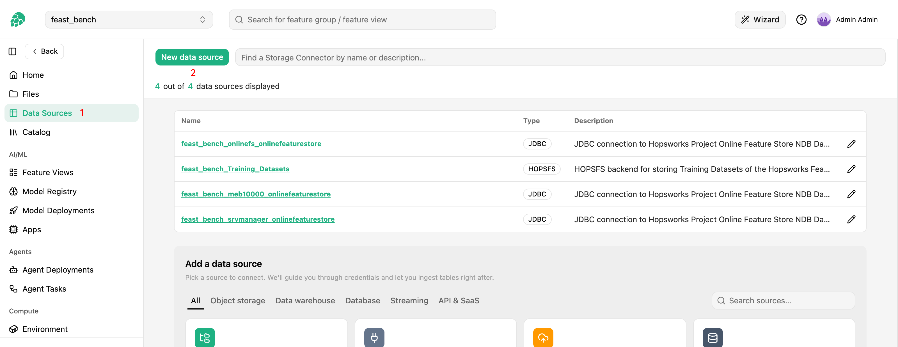
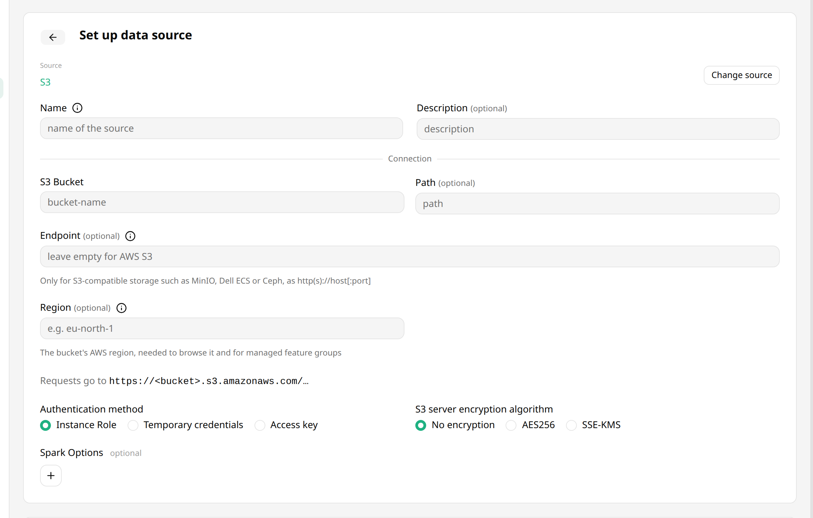
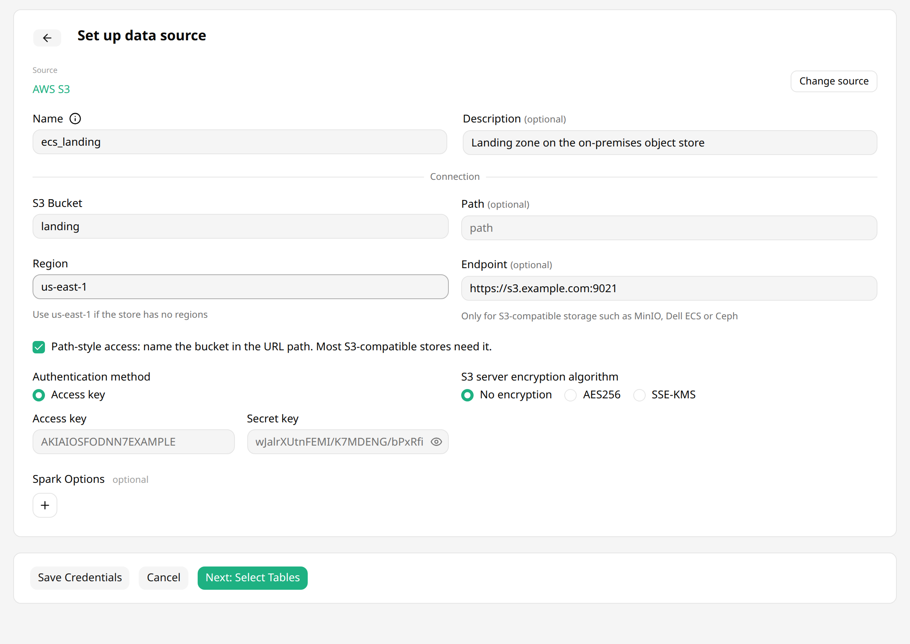

# How-To set up a S3 Data Source { #data-source-s3 }

## Introduction

Amazon S3 or Amazon Simple Storage Service is a service offered by AWS that provides object storage.
That means you can store arbitrary objects associated with a key.
These kinds of storage systems are often used as Data Lakes with large volumes of unstructured data or file based storage.
Popular file formats are `CSV` or `PARQUET`.

There are so called Data Lake House technologies such as Delta Lake or Apache Hudi, building an additional layer on top of object based storage with files, to provide database semantics like ACID transactions among others.
This has the advantage that cheap storage can be turned into a cloud native data warehouse.
These kinds of storages are often the source for raw data from which features can be engineered.

In this guide, you will configure a Data Source in Hopsworks to save all the authentication information needed in order to set up a connection to your AWS S3 bucket.
The same data source also connects to an S3-compatible store such as MinIO, Dell ECS or Ceph, see [S3-compatible storage][data-source-s3-compatible].
When you're finished, you'll be able to read files using Spark through Hopsworks APIs.
You can also use the connector to write out training data from the Feature Store, in order to make it accessible by third parties.

## Prerequisites

Before you begin this guide you'll need to retrieve the following information from your AWS S3 account and bucket:

- **Bucket:** You will need a S3 bucket that you have access to.
  The bucket is identified by its name.
- **Path (Optional):** If needed, a path can be defined to ensure that all operations are restricted to a specific location within the bucket.
- **Region (Optional):** You will need an S3 region to have complete control over data when managing the feature group that relies on this data source.
  The region is identified by its code.
  An S3-compatible store requires it.
- **Endpoint (S3-compatible storage only):** The address of the store, as `http(s)://host[:port]`.
- **Authentication Method:** You can authenticate using Access Key/Secret, or use IAM roles.
  If you want to use an IAM role it either needs to be attached to the entire Hopsworks cluster or Hopsworks needs to be able to assume the role.
  See [IAM role documentation][aws-iam-role-chaining] for more information.
  An S3-compatible store authenticates with Access Key/Secret only.
- **Server Side Encryption details:** If your bucket has server side encryption (SSE) enabled, make sure you know which algorithm it is using (AES256 or SSE-KMS).
  If you are using SSE-KMS, you need the resource ARN of the managed key.

## Creation in the UI

### Step 1: Set up new Data Source

Head to the `Data Sources` view on Hopsworks (1) and click `New data source` (2).
The `Add a data source` catalog lists the available sources, grouped under `Object storage`, `Data warehouse`, `Database`, `Streaming` and `API & SaaS`.
Pick the `S3` card to open the creation form.

<figure markdown>
  
  <figcaption>The Data Source View in the User Interface</figcaption>
</figure>

### Step 2: Enter Bucket Information

Enter the details for your S3 connector.
The `Source` line at the top of the form shows `S3`, and `Change source` takes you back to the catalog.
Start by giving it a **name** and an optional **description**.
And set the name of the S3 Bucket you want to point the connector to.
Optionally, specify the region if you wish to have a Hopsworks-managed feature group stored using this connector.
For an S3-compatible store, fill in the **Endpoint** as well; the form then offers **Path-style access**, see [S3-compatible storage][data-source-s3-compatible].
Under the region, the form shows the URL that requests go to, built from the bucket, path, endpoint, path style and region, for example `https://landing.s3.eu-north-1.amazonaws.com/...` on AWS.

<figure markdown>
  
  <figcaption>S3 Connector Creation Form</figcaption>
</figure>

### Step 3: Configure Authentication

#### Instance Role

Choose instance role if you have an EC2 instance profile attached to your Hopsworks cluster nodes with a role which grants you access to the specified bucket.

#### Temporary Credentials

Choose temporary credentials if you are using [AWS Role chaining][aws-iam-role-chaining] to control the access permission on a project and user role base.
Once you have selected *Temporary Credentials* select the role that give access to the specified bucket.
For this role to appear in the list it needs to have been configured by an administrator, see the [AWS Role chaining documentation][aws-iam-role-chaining] for more details.

!!! warning "Session Duration"
    By default, the session duration that the role will be assumed for is 1 hour or 3600 seconds.
    This means if you want to use the data source for example to write [training data to S3][writing-training-data], the training dataset creation cannot take longer than one hour.

    Your administrator can change the default session duration for AWS data sources, by first [increasing the max session duration of the IAM Role](https://docs.aws.amazon.com/IAM/latest/UserGuide/id_roles_use.html#id_roles_use_view-role-max-session) that you are assuming.
    And then changing the `fs_data_source_session_duration` [configuration variable][cluster-configuration] to the appropriate value in seconds.

#### Access Key/Secret

The most simple authentication method are Access Key/Secret, choose this option to get started quickly, if you are able to retrieve the keys using the IAM user administration.

### Step 4: Configure Server Side Encryption

Additionally, you can specify if your Bucket has SSE enabled.

#### AES256

For AES256, there is nothing to do but enabling the encryption by toggling the `AES256` option.
This is using S3-Managed Keys, also called [SSE-S3](https://docs.aws.amazon.com/AmazonS3/latest/userguide/serv-side-encryption.html).

#### SSE-KMS

With this option the [encryption key is managed by AWS KMS](https://docs.aws.amazon.com/AmazonS3/latest/userguide/serv-side-encryption.html), with some additional benefits and charges for using this service.
The difference is that you need to provide the resource ARN of the key.

If you have SSE-KMS enabled for your bucket, you can find the key ARN in the "Properties" section of the bucket details on AWS.

### Step 5: Add Spark Options (optional)

Here you can specify any additional spark options that you wish to add to the spark context at runtime.
Multiple options can be added as key - value pairs.
Options starting with `fs.s3a.` configure Spark's S3A client, for example `fs.s3a.endpoint` to reach a regional AWS endpoint.

To connect to an S3-compatible store, set the **Endpoint** instead of the `fs.s3a.endpoint` and `fs.s3a.path.style.access` options.
Spark reads those options in full, the Python engine and the Arrow Flight server only in part, and the backend not at all, so browsing and deleting data still reach AWS.
The endpoint reaches every Hopsworks client, and a data source cannot have both.

!!! warning "Spark Configuration"
    When using the data source within a Spark application, the credentials are set at application level.
    This allows users to access multiple buckets with the same data source within the same application (assuming the credentials allow it).
    You can disable this behaviour by setting the option `fs.s3a.global-conf` to `False`.
    If the `global-conf` option is disabled, the credentials are set on a per-bucket basis and users will be able to use the credentials to access data only from the bucket specified in the data source configuration.

### Step 6: Save changes

Click on "Save Credentials".

## S3-compatible storage { #data-source-s3-compatible }

An S3 data source with an **Endpoint** connects to an S3-compatible store instead of AWS.
The backend, Spark, the Python engine and the Arrow Flight server all use the endpoint, so browsing, reading, writing and deleting data all reach the store.

Set these fields:

- **Endpoint:** `http(s)://host[:port]`, without a path, for example `https://s3.example.com:9021`.
  The scheme decides whether the connection uses TLS.
  When the store's certificate comes from a private CA, an administrator makes the cluster trust it, see [Private CA Trust][private-ca-trust].
  Hopsworks refuses `localhost` and loopback, link-local and unspecified addresses.
- **Path-style access:** Turn it on when the store does not resolve a host name per bucket, which is the case for most on-premises stores.
  The bucket is then sent in the URL path, `https://s3.example.com:9021/landing/...`, instead of the host name, `https://landing.s3.example.com:9021/...`; the request URL under the region shows which.
- **Region:** The region the store is configured with.
  Left empty, it is `us-east-1`, which stores without regions accept; the field shows it as its placeholder.
  A store configured with another region refuses requests signed for `us-east-1`, so set its region here.
- **Access Key/Secret:** Required.
  Instance roles and temporary credentials go through AWS, so the form does not offer them with an endpoint.

<figure markdown>
  
  <figcaption>S3 Connector on an S3-compatible store</figcaption>
</figure>

The data source can also be created with the Python API:

```python
import hopsworks
from hsfs.storage_connector import S3Connector


project = hopsworks.login()
fs = project.get_feature_store()

sc = S3Connector(
    id=None,
    name="ecs_landing",
    featurestore_id=fs.id,
    bucket="landing",
    region="us-east-1",
    access_key="<access key>",
    secret_key="<secret key>",
    endpoint="https://s3.example.com:9021",
    path_style_access=True,
)
sc.save()
```

What the store must support:

- Signature Version 4 requests signed with an access key and secret key.
- `Content-MD5` on multi-object deletes, which Hopsworks sends when it deletes the data of a feature group.
- Conditional writes (`If-None-Match`), for Delta tables written by the Python engine, which uses them to commit.

Things to know:

- Changing the endpoint or the bucket of a data source points it at different storage.
  Data already written stays where it is, so feature groups on the data source no longer find it.
- With an endpoint, Hopsworks sends a checksum only where an operation requires one, and `Content-MD5` on multi-object deletes, because stores such as Dell ECS refuse the CRC32 and CRC64NVME checksums that recent AWS SDKs add by default.
  The Spark options `fs.s3a.checksum.generation` and `fs.s3a.create.checksum.algorithm` turn them back on for Spark.
- An update that leaves the endpoint out, as an older client sends it, keeps the stored endpoint.
  To remove the endpoint, set it to an empty string.
- Spark sets the endpoint for the data source's bucket only, so other buckets in the same Spark application still reach AWS.
  A data source with an endpoint raises an error for a path in another bucket.
- Spark creates one S3 client per bucket and reuses it for the life of the application.
  A data source whose bucket name the application already used on another store, or with another endpoint, raises an error, and works in a new Spark application.
  This includes a Glue table whose location is in a bucket with that name, and it holds across a reconnect to Hopsworks in the same application.
  A changed region or key also takes effect in the next Spark application.
- The endpoint needs Hopsworks 5.3 or later on the cluster and in the Python or Java client.
  An older client ignores the endpoint and sends requests to AWS.

!!! api "API reference"

    - <code class="doc-symbol doc-symbol-class"></code> [`S3Connector`][hsfs.storage_connector.S3Connector]
        - <code class="doc-symbol doc-symbol-attribute"></code> [`endpoint`][hsfs.storage_connector.S3Connector.endpoint]
        - <code class="doc-symbol doc-symbol-attribute"></code> [`path_style_access`][hsfs.storage_connector.S3Connector.path_style_access]
        - <code class="doc-symbol doc-symbol-method"></code> [`save`][hsfs.storage_connector.StorageConnector.save]

    <a class="hops-api-cta" href="../../../../../python-api/hopsworks/">Browse the full Python API :material-arrow-right:</a>

## Next Steps

Move on to the [usage guide for data sources][data-source-usage] to see how you can use your newly created S3 connector.
