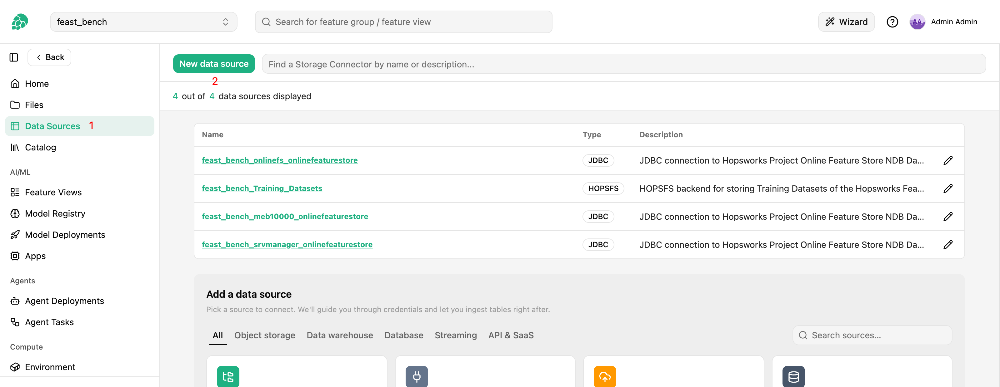

# How-To set up an SFTP Data Source { #data-source-sftp }

## Introduction

An SFTP data source connects a Hopsworks project to a directory on an SFTP server, reached over SSH.
It does not back feature groups and cannot be read with Spark.
Instead, it is the source of a [files ingestion job][files-ingestion], which copies the files under a path of the server, whatever their format, into a dataset of the project, either once or on a schedule, with optional mirroring of deletions and a file index feature group.

The job reads the server with the dltHub `filesystem` source over [paramiko](https://www.paramiko.org/), and gives up after 60 seconds on a connection, a banner or a login that does not complete.
Data only flows from the server into Hopsworks.
Changes made in the dataset are never written back to the server.

## Prerequisites

### Server

- **Host and port**: the server must be reachable from the cluster, both from the Hopsworks backend, which tests the connection, and from the Kubernetes pods that run the ingestion jobs.
  Clusters that restrict outbound traffic must allow the host and port, `22` by default.
- **User**: an account on the server with read access to the files to copy.
  Hopsworks only lists and downloads, so a read-only account is enough.
- **Root path**: the absolute directory on the server under which the files live, `/` by default.
  Every prefix of a files ingestion job is relative to it, so an account chrooted to its home directory typically uses `/`.

### Credentials

The data source authenticates with one of:

- a **password**, or
- a **private key** in PEM format (`-----BEGIN ... PRIVATE KEY-----`), with an optional **passphrase**.
  Keys in other formats, such as PuTTY `.ppk`, must be converted to PEM first.

The password, key and passphrase are stored in the Hopsworks secret store and never returned by the API or shown in the UI again; the data source only reports that credentials are set.

### Client version

The Python client and the `hops` CLI support SFTP data sources from Hopsworks 5.3.0.
Clients older than 5.3.0 do not know the SFTP type and fail to list a feature store's data sources once it has one, so upgrade the client in environments that list data sources.

## Creation in the UI

### Step 1: Set up a new data source

Head to the `Data Sources` view in Hopsworks and click `New data source`.
Pick the `SFTP` card, in the `Files & documents` category.

<figure markdown>
  
  <figcaption>The Data Source view in the user interface</figcaption>
</figure>

### Step 2: Enter the connection details

<!-- TODO screenshot sftp_creation.png to capture; uncomment once the file exists:
<figure markdown>
  
  <figcaption>The SFTP creation form</figcaption>
</figure>
-->

1. **Name** and an optional **Description**.
2. **Host**: the host name or IP address of the server, without a scheme or a path, such as `sftp.example.com`.
3. **Port**: `22` by default.
4. **Username**.
5. **Root path**: an absolute path, `/` by default.
   It must start with `/` and cannot contain `..`.
6. **Authentication**: `Password`, with the password, or `Private key`, with the PEM private key pasted into the text area and the passphrase if the key has one.

Click `Test connection` to check that the server is reachable.
Hopsworks checks that an SSH server answers at the host and port, and reports `SSH server reached at <host>:<port>` when it does.
The test does not log in, so a wrong username, password or key is only found by the first run of a files ingestion job.

Click `Next` to save the data source and go on to the second step of the wizard, `Copy files into a dataset`, described in the [files ingestion guide][files-ingestion].
The `Browse` button of the prefix is not available for SFTP, so type the prefix.

### Editing the data source

The data source page shows the host, port, username, root path and authentication method, and that credentials are set.
Saving the form without a new password or key keeps the stored one; enter a new one to replace it.
The next run of each files ingestion job uses the new credentials.

## Using the Python client

```python
import hopsworks
from hsfs.storage_connector import SftpConnector


project = hopsworks.login()
fs = project.get_feature_store()

sftp = fs.create_data_source(
    SftpConnector(
        id=None,
        name="handbook_sftp",
        featurestore_id=fs.id,
        host="sftp.example.com",
        port=22,
        username="ingest",
        path="/data",
        auth_type="PASSWORD",
        password=hopsworks.get_secrets_api().get_secret("sftp_password").value,
    )
).storage_connector

print(sftp.credentials_set)  # True; password, private_key, passphrase read as None

job = sftp.ingest_files(dataset="handbook", prefix="handbook/2026/")
```

For a private key, pass `auth_type="PRIVATE_KEY"` and the PEM text as `private_key`, with `passphrase` when the key has one:

```python
from pathlib import Path

import hopsworks
from hsfs.storage_connector import SftpConnector


project = hopsworks.login()
fs = project.get_feature_store()

sftp = fs.create_data_source(
    SftpConnector(
        id=None,
        name="handbook_sftp",
        featurestore_id=fs.id,
        host="sftp.example.com",
        username="ingest",
        path="/data",
        auth_type="PRIVATE_KEY",
        private_key=Path("~/.ssh/ingest.pem").expanduser().read_text(),
        passphrase=None,
    )
).storage_connector
```

`auth_type` is `PASSWORD` or `PRIVATE_KEY` and may be left out, since it follows from the credential given.
`password`, `private_key` and `passphrase` are write-only: they are sent when the data source is created or updated and read back as `None`, and `credentials_set` tells whether the data source has credentials.
An update that leaves them out keeps the stored credentials; to rotate them, call `set_credentials` with the new password or key and then `update`:

```python
import hopsworks


project = hopsworks.login()
fs = project.get_feature_store()

sftp = fs.get_data_source("handbook_sftp").storage_connector
sftp.set_credentials(password="...")
sftp.update()
```

!!! api "API reference"

    - <code class="doc-symbol doc-symbol-method"></code> [`FeatureStore.create_data_source`][hsfs.feature_store.FeatureStore.create_data_source]
    - <code class="doc-symbol doc-symbol-method"></code> [`FeatureStore.get_data_source`][hsfs.feature_store.FeatureStore.get_data_source]
    - <code class="doc-symbol doc-symbol-class"></code> <autoref identifier="hsfs.storage_connector.SftpConnector" optional><code>SftpConnector</code></autoref>
        - <code class="doc-symbol doc-symbol-method"></code> <autoref identifier="hsfs.storage_connector.SftpConnector.set_credentials" optional><code>set_credentials</code></autoref>
    - <code class="doc-symbol doc-symbol-class"></code> [`StorageConnector`][hsfs.storage_connector.StorageConnector]
        - <code class="doc-symbol doc-symbol-method"></code> <autoref identifier="hsfs.storage_connector.StorageConnector.ingest_files" optional><code>ingest_files</code></autoref>
        - <code class="doc-symbol doc-symbol-method"></code> [`update`][hsfs.storage_connector.StorageConnector.update]
    - <code class="doc-symbol doc-symbol-docs"></code> [paramiko](https://www.paramiko.org/)

    <a class="hops-api-cta" href="../../../../../python-api/hopsworks/">Browse the full Python API :material-arrow-right:</a>

## Using the CLI

```bash
hops datasource create sftp handbook_sftp \
    --host sftp.example.com --port 22 --username ingest --path /data \
    --password - < password.txt
hops datasource create sftp handbook_sftp_key \
    --host sftp.example.com --username ingest --path /data \
    --private-key-file ~/.ssh/ingest.pem --passphrase -
hops datasource ingest-files handbook_sftp --dataset handbook --prefix handbook/2026/
```

`--password` and `--private-key-file` are alternatives; `--passphrase` goes with the key.
`--private-key-file` reads the PEM file on your machine and sends its content, so the file itself never needs to be in the project.
A secret option given as `-` reads one line from standard input, and each secret option also reads the environment variable `HOPSWORKS_DS_SFTP_<OPTION>`, such as `HOPSWORKS_DS_SFTP_PASSWORD`, so secrets do not appear on the command line.

## Next steps

Copy the files under a path of the server into a dataset with a [files ingestion job][files-ingestion].
The prefix of the job is relative to the root path of the data source, and a run reads `sftp://<host>:<port><root path>/<prefix>`, so a data source with root path `/data` and a job with prefix `handbook/` copies the files under `/data/handbook/` on the server.
The manifest and the index feature group, when turned on, record `sftp` in `source_type` and each file as `sftp://<host><absolute path>` in `source_url`, without the port or the user, so `sftp://sftp.example.com/data/handbook/a.pdf` in the example.

## Limitations

- An SFTP data source is read-only and files-only.
  It backs no feature groups, cannot be read with Spark, and the dltHub table ingestion does not offer it.
- Files are copied one at a time and the directory is listed in full on every run, so a very large tree is better split into several jobs with narrower prefixes.
- Browsing the server for a prefix is not available; type the prefix.
- `Test connection` only checks that an SSH server answers at the host and port; the credentials are checked by the first run.
  Testing a server at a private or cluster-internal address needs an administrator to enable the `sftp_allow_private_ranges` variable.
